# 제본 코일 끝단 공정 — 현장 기록 (2026-11-12 방문)

- 출처: 방문자 기억(호이) + 샘플로 책상에서 공정을 재현한 사진 11장(11/13) + 녹음
- 같이 읽기: [미팅 정리](2026-11-12_미팅-스프링공장.md) · [요구사항 분석](2026-11-12_요구사항-스프링공장.md) · [화자별 원문](2026-11-12_미팅-스프링공장-스크립트.md)
- 사진의 펜과 롱노우즈는 **공장 기계를 대신한 소품**이다. 실제 설비 사진이 아니다

## 0. 한 줄로

기계가 **1.5초마다 코일 2개를 포갠 세트**를 내놓는다 → 사람이 그 세트 둘 중 **하나를 뒤집어 다른 하나 위에 얹어 4개 묶음**을 만든다 → 묶음을 **트레이 칸(5칸)**에 넣는다. **로봇이 맡을 것은 뒤의 두 단계**다.

```
타래 ─▶ [기계] 2줄 병렬 인출·절단 ─▶ [기계] 2개 포개기 ─▶ 2개 세트 (1.5초/세트)
                                                         │
                       ┌─────────────────────────────────┘
                       ▼            ◀── 여기부터 로봇
        세트 A ─┐
        세트 B ─┴─ 뒤집기 ─▶ A 위에 얹기 ─▶ 4개 묶음 ─▶ 트레이 칸(1~5) ─▶ [사람] 층 쌓기·박스
```

## 1. 참석자 (녹취 화자 번호는 클로바노트 기준)

| 클로바 | 사람 | 역할 |
|---|---|---|
| 참석자 1 | 짱짱맨님 | 포너즈 PM, 진행 |
| 참석자 2 | 호이 | 포너즈, 기술 질문(인터페이스·팔 내구성) |
| 참석자 8 | 차장님 | 공장 — 공정 설명, 10년 전 4개짜리 자동화를 만든 사람 |
| 참석자 7, 11 | 담당자님 | 공장 — 인증·포장(간지) 설명 |
| 참석자 10 | 동행자(연결) | 공장을 소개한 사람, 차로 이동 |
| 미배정(3 추정) | 용용이 | 포너즈 |

## 2. 공정 — 사진으로

### ① 기계가 타래에서 2줄을 병렬로 뽑아 스스로 자른다
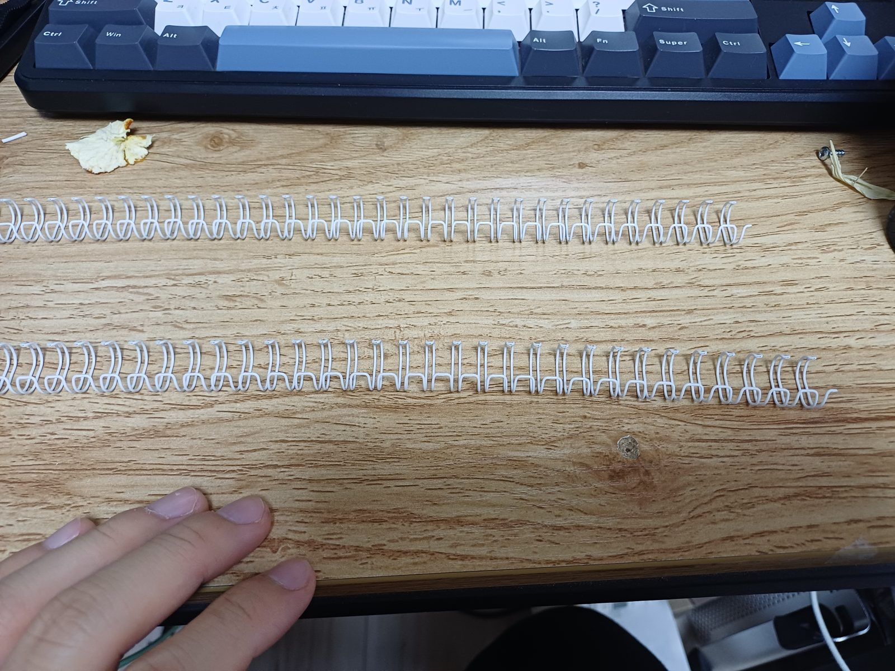
코일 하나하나가 따로 나오는 상태. 위·아래가 한 줄씩.

### ② 기계가 두 줄을 합쳐 2개가 정확히 포개지게 한다
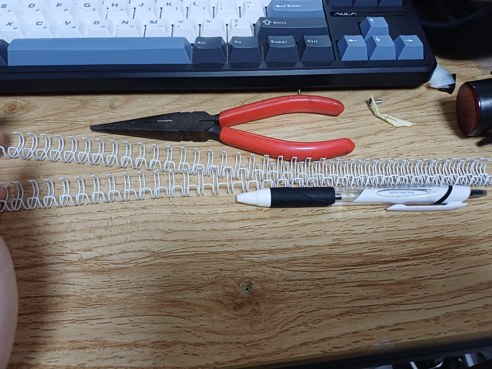
롱노우즈·펜 = 합치는 기계. 두 코일의 고리가 서로 사이사이로 들어간다.
- **피치가 틀어지거나 고리가 엉뚱한 자리에 들어가면** 두 코일을 다시 떼기가 매우 까다롭고, 합쳐지지도 않는다
- 그래서 피치 정합이 **시스템 최고 속도를 정한다**(녹취: 지금 속도 = 피치가 안 틀어지는 최대값)

### ③ 합쳐진 2개 세트
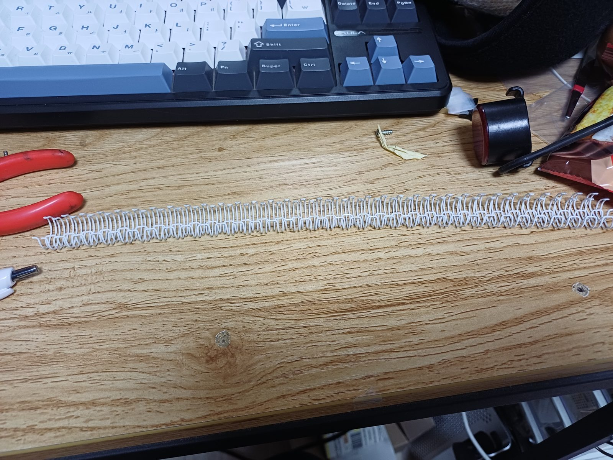
**약 1.5초에 한 세트**가 만들어져 작업 테이블에 공급된다.

### ④ 세트 둘을 모은다
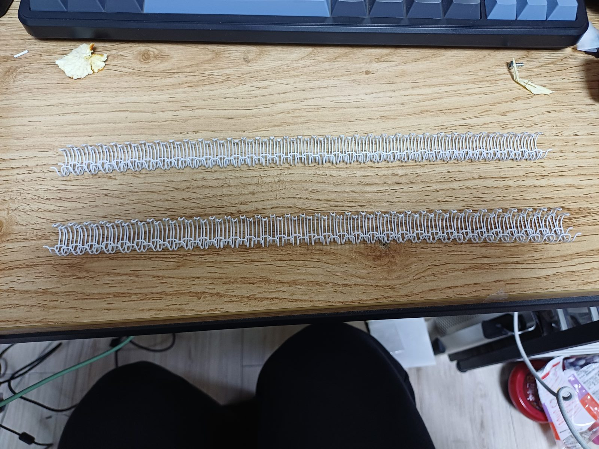

### ⑤ 한 세트를 뒤집는다
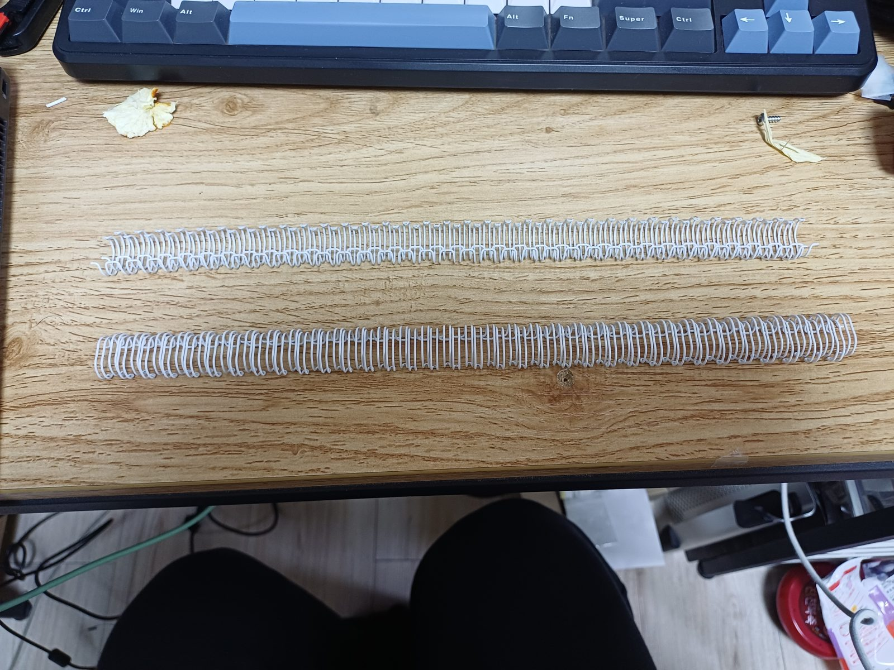
위 = 원래 방향, 아래 = 뒤집은 세트.

### ⑥~⑧ 포개서 4개 한 묶음으로
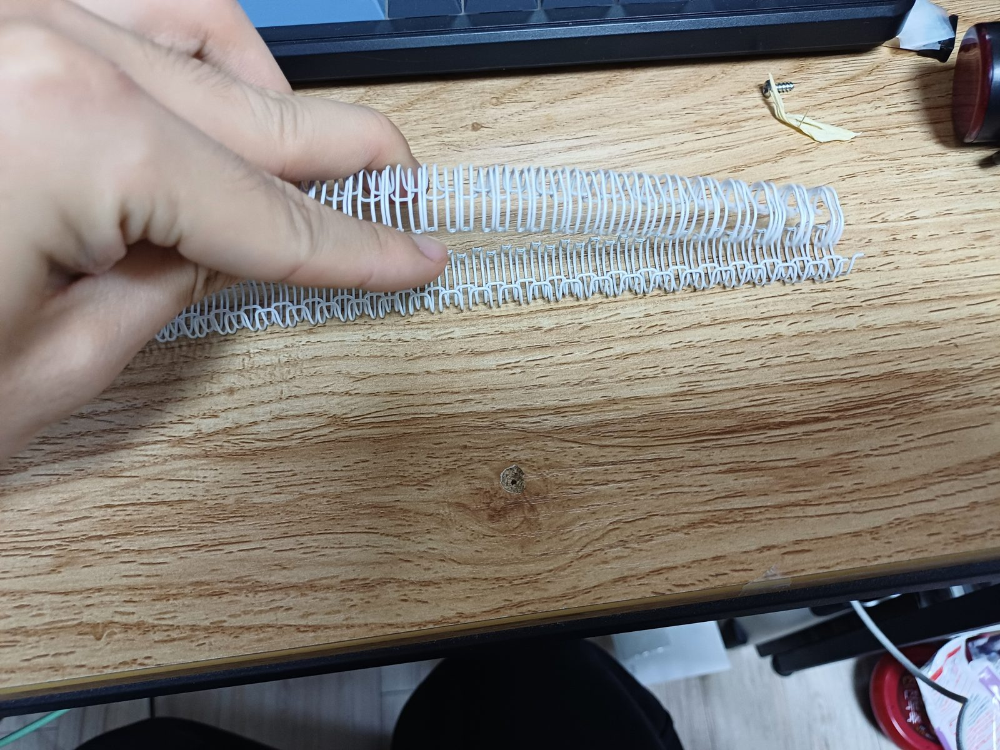
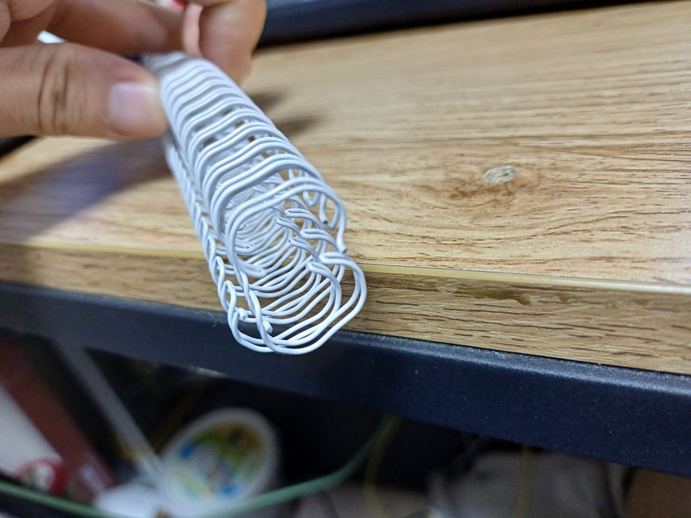
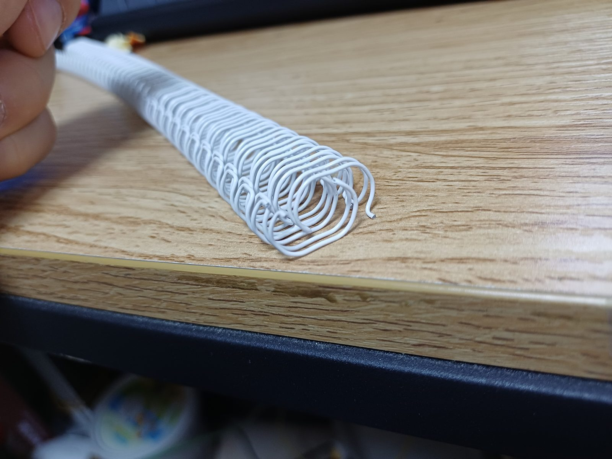
지금은 사람이 잡아서 포갠다. 로봇은 **한 세트를 잡아 다른 세트 위에 올리면** 될 것으로 본다.
07·08은 끝에서 본 모습 — 두 세트의 고리가 맞물려 하나의 관처럼 된다.

### ⑨ 완성된 4개 묶음
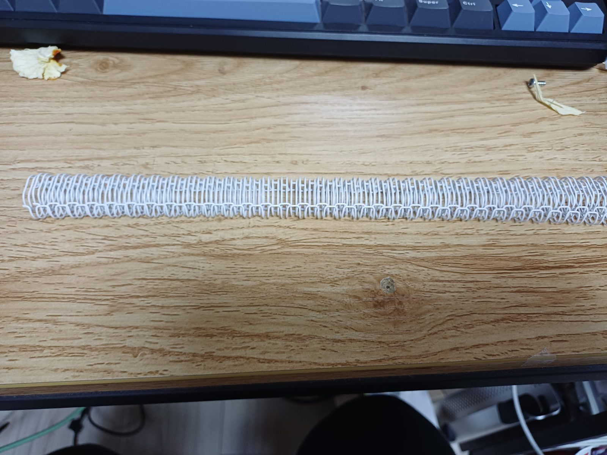
한 손으로 들 수 있다(가볍다).

### ⑩ 트레이
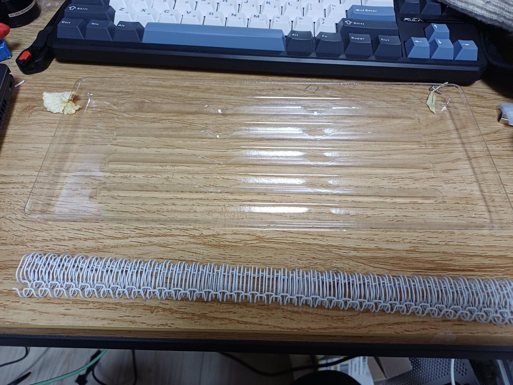
투명 성형 트레이, **5칸 = 묶음 5개가 한 세트**. 포장 박스의 각 층에 끼운다.
- 녹취로 보면 트레이 포장은 **해외 수출용**
- **대부분인 내수용은 펄프지(간지)**를 쓴다 → 종이는 진공 집게로 못 집어서 자동화가 어렵다 → **이번에는 다루지 않기로 했다**(녹취)

### ⑪ 트레이에 넣은 모습
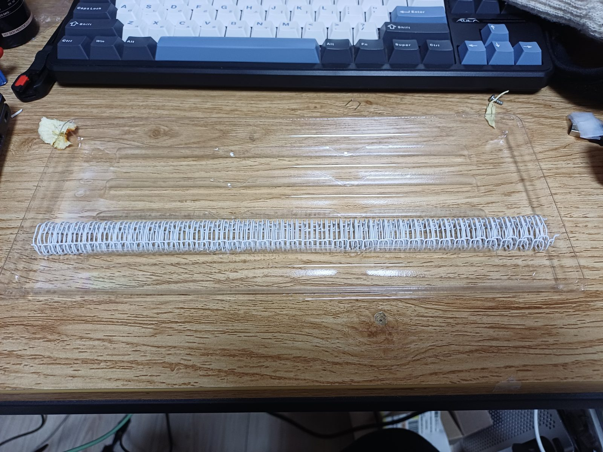
일부러 2번째 칸에 넣었다. 실제로는 다섯 칸을 모두 채운다.

## 로봇이 할 일 (11/13 확정)
**사진 5 상태에서 시작해 두 세트를 포개고(사진 6~9), 사진 11처럼 트레이의 빈칸을 모두 채운다.** 뒤집기는 로봇 범위 밖.

## 3. 뒤집기를 누가 하나

- 기계 쪽에서 **통로를 지나며 뒤집히게 하는 장치**를 달 수는 있다
- 대가: 뒤집힌 쪽이 나오는 위치가 **1~2m 옮겨진다**(녹취 — 스크류 방식은 토출 후 자리 잡는 거리가 길다)
- 그래서 선택지는 둘이다
  - **A. 로봇이 뒤집는다** — 설비는 그대로, 로봇 동작이 하나 늘어난다
  - **B. 기계가 뒤집는다** — 로봇은 얹기만, 대신 라인이 1~2m 길어지고 두 출구가 멀어진다

## 4. 숫자로 보는 사이클 예산

| 항목 | 값 | 근거 |
|---|---|---|
| 2개 세트 공급 | 1.5초/세트 | 현장 관찰 |
| 4개 묶음 하나 = 세트 2개 | 3초/묶음 | 계산 |
| 트레이 하나 = 묶음 5개 | 15초/트레이 | 계산 |
| 로봇이 사람보다 약 3배 느리면 | 약 9초/묶음, 45초/트레이 → 기계를 1/3 속도로 | 녹취 [16:42] "3배 느림" 감안, 기계 3단계 속도 |

→ 로봇 한 대로 지금 속도를 따라가려면 **묶음 하나(잡기·뒤집기·얹기·옮기기·놓기)를 3초 안에** 끝내야 한다. 못 따라가면 기계 속도 단계를 낮춘다(요구사항 I-2).

## 5. 제품 치수 (추정 — 샘플로 확인할 것)

- "34공" = **고리 34개**로 보인다. 트윈링 3:1 피치(8.47mm)에서 A4 길이(297mm)가 34고리라 맞아떨어진다 → 길이 약 290mm
- "9.5" "11" = **코일 지름(mm)**으로 보인다. 트윈링 표준 지름 9.5mm(3/8")·11.1mm(7/16")와 맞는다
- 샘플에서 고리 수·길이·지름·무게를 재서 이 칸을 확정한다

## 6. 녹취만으로 정리했을 때와 달라진 이해

- 로봇의 단위는 **코일 2개가 아니라 "2개 세트 두 개 → 4개 묶음"**이다(앞 정리본은 "2개를 겹쳐"로 적었다)
- 10년 전 "4개짜리" 기계 = 위에서 2개 + 아래서 뒤집힌 2개가 **기계 안에서** 바로 4개 묶음이 되던 것. 지금 기계는 2개 세트까지만 하고, 4개로 합치는 일은 사람이 한다
- 트레이 vs 간지: 트레이는 수출용 일부, **내수 대부분은 펄프지라 이번 범위에서 빠졌다**
