# 개발일지 2026-11-05 — 집 안 자율 탐색 · 쓰러진 나무 · 위치 오차

> 한 줄 요약: **"방 둘러보기"를 만들어 실기로 돌렸지만, 이 집에선 제자리 한 바퀴를 돌 자리가 없어 자율 탐색은 실패했다.**
> 지도 기준 위치는 크게 틀리지 않았다(깊이 101점 중 99점이 지도와 맞음). 막힌 원인은 **감지 범위(앞 58°·60cm 사각·납작한 물건)**와
> **엔코더 미연결**이다. 납작한 물건 찍기·전진 방향 붙잡기·진척 없음 정지는 넣었고, 위치를 확실히 하는 다음 단계(회전판 스윕 보정·ArUco·엔코더 배선)를 정했다.

## 1. 한 일

| 요청 | 결과 | 커밋 |
|---|---|---|
| 방을 다니며 토마토 그루 찾기(쓰러져 있어도) | **🧭 방 둘러보기**(스캔 → 토마토 찾기 → 가까운 경계로 가기 반복) · 쓰러진 나무 열매도 찾기에 넣음 · 찾은 토마토가 자리를 옮겨도 쌓임 | `68b14a7` |
| 큰방으로 나가 주행 | 문틈(약 0.65m, 차체 0.44m)을 손으로 한 걸음씩 통과 — 열매·문틀을 스치며 성공 | — |
| 수건을 못 피한다 | 앞 컬러 카메라로 **바닥의 진한 색(수건·매트)을 장애물로** 찍음 · 전진 중 **IMU 방향 붙잡기** | `adf8fba` |
| Astra 깊이 화면이 이상하다 | 좌우는 이미 맞음 → 세로로 늘어나 보이던 것을 **컬러와 같은 배율**로 | `adf8fba` |
| 웹 공간 지도에서 이동 | **옮기기**(오른쪽 끌기·Shift+끌기·두 손가락) · 두 번 누르면 로봇으로 | `00a1960` |
| 작은 방으로 되돌아가지 말고 세대 전체 | 둘러보기 **제외 구역 `--avoid`** | `00a1960` `4829126` |
| 지금 장치로 위치를 완전히 | 회전판+손목 D405 스윕 실험 → **팔→차체 변환이 틀려 있음** 발견. ArUco 인쇄물 준비 | `15ce227` |
| 엔코더로 위치 제어 | 인터페이스(`M` 거리 이동)는 이미 있음 → **엔코더 신호가 Uno에 안 들어옴** 재확인 | `15ce227` |

## 2. 실기에서 본 것 (숫자)

### 2.1 제자리 한 바퀴가 안 된다 — 탐색이 막힌 1번 원인
- 작은 방 3번, 큰방 1번 모두 첫 자리 한 바퀴 실패: **84° · 153° · 128° · (왼 56°/오른 148°)**에서 회전 지령 255로도 IMU 0°.
- 정지마찰이 아니라 **몸체가 벽·서랍장·가방에 닿은 것**이다. 벽에서 16cm 떼자 지령 180에서 바로 돌았다.
- 회전 중심이 차체 뒤쪽이라 제자리 회전에 **지름 ≈0.9m**가 비어 있어야 한다. 이 집엔 그런 자리가 드물다.
- Astra는 **앞 58°·60cm 밖**만 본다 → 옆·뒤에 닿을지를 미리 모른다.

### 2.2 위치 오차 — 지도 기준으론 작다
- 수건 위에서 그 자리 깊이 한 장을 지도에 대 보니 **101점 중 99점이 지도 벽과 일치**.
- 크게 틀어졌던 두 경우는 고쳤다:
    - 막힌 채 전진을 60번 밀었을 때 맞춤 잡음(3~5cm)이 "움직였다"로 보여 **지도가 0.35m 미끄러짐** → *10걸음째 목표에 5cm도 못 다가가면 정지*.
    - 전진(255×1.2초)마다 **왼쪽으로 5~10° 틀어짐** → *전진 중 IMU 비례 제어*(`HOLD_K` 15, 상한 150).
- 오늘은 **전진 200·230 ×1초가 0**, 255×1.2초가 20~35cm였다(배터리·바닥에 따라 다름).

### 2.3 장애물을 못 본 이유 — 위치가 아니라 감지
| 물건 | 왜 안 보였나 | 대응 |
|---|---|---|
| 쓰러진 화분·나무 | Astra 깊이 화각(±29°) 밖에 있었다 | 그쪽으로 돌리자 0.6~0.9m로 잡힘 |
| 수건·매트 | 바닥 위 5cm 아래는 장애물로 안 칠함 + 마루는 IR 반사가 없어 깊이 0 | **앞 컬러로 진한 색 바닥 찍기** — 같은 자리에서 122칸 |
| 검은 외투·얇은 의자 다리 | IR을 흡수/너무 가늘어 깊이에 안 잡힘 | 미해결(한 번 닿음) |
| 60cm 안의 서랍장 | Astra 사각 | 회전판+손목 D405 스윕(아래 3.1) |

### 2.4 쓰러진 나무
- tomato-vision은 화면 y 600 아래를 "낙과"로 따로 세고 **공중 열매만 위치 목록에** 실었다. 렌즈가 15cm라 바닥 근처 열매는 0.6m 안쪽부터 그 줄 아래로 내려가 지도에서 빠졌다 → 이제 `ground`로 같이 싣고 찾기가 둘 다 쓴다.
- 열매 거리 재기에서 바닥 띠(5cm 아래)를 빼지 않게 했다.
- 실기에서 쓰러진 열매를 앞 카메라가 여러 번 검출했다(cx 334·842 등). **찾기 전 과정을 쓰러진 나무로 끝까지 돌리지는 못했다**(스캔이 막혀서).

### 2.5 손목 D405 스윕 실험 — 팔→차체 변환이 틀렸다
- 회전판(기본 자리 −88.9° → +90°, 약 180°)을 돌리면 손목 D405(0.07~0.9m, 유효 95%)가 앞→옆→뒤 **약 270°**를 덮는다. Astra와 합치면 거의 360°다.
- 그런데 지금 `wrist_to_body`(회전판 0° = 팔 정면 = 차체 정면 전제)로는 정면 문틀이 **왼쪽 뒤 59~156°**에 찍혀 지도와 **0.3%**만 겹쳤다. 10/24 회전판 기본 자리를 −88.9°로 바꿀 때 이 사슬을 안 고쳤다.
- 회전 오프셋 탐색: 지도 겹침으로는 **≈ −120°(29%)**, Astra와 직접 맞추면 **−116° / −156°** 두 후보 — 확정 못 함(손-눈 평행이동 오차도 섞임).

### 2.6 엔코더
- 보드는 v2.3이고 하트비트에 `enc=`가 실린다. 255로 1초 전진·후진(로직 5V가 4.4V까지 처짐) 동안 **`enc=0,0,0,0`**.
- 굴리는 동안 `?`를 30ms마다 40번 읽어도 **D2~D7·B·C 포트 핀이 한 번도 안 바뀜**(D1 TX만). 11/04 탐침과 같다 — 엔코더 신호가 Uno 어느 핀에도 안 온다.
- 거리 이동 인터페이스는 이미 있다: 펌웨어 `M id t vx vy w`(보드가 앞바퀴 카운트를 세며 감속·걸림 정지·리셋 뒤 진행 보존) + `MotorLink.drive_ticks()`(리셋되면 남은 만큼 재시도). **막힌 건 배선뿐**.
- ⚠ 젯슨의 `motor_link.py`는 **10/22판**(enc·`M` 없음) — 배선 뒤 PC판을 배포해야 한다.

### 2.7 사진 기록 (시간순)

> 왼쪽 = 차체 앞 **Astra 컬러**(tomato-vision 주석 포함, 렌즈 높이 15cm) · 오른쪽 = **손목 D405**(대기 자세, 주행 정면). 젯슨이 그 순간 쓴 그림 그대로다.

**① 시작 — 작은 방, 쓰러진 화분 앞**

| 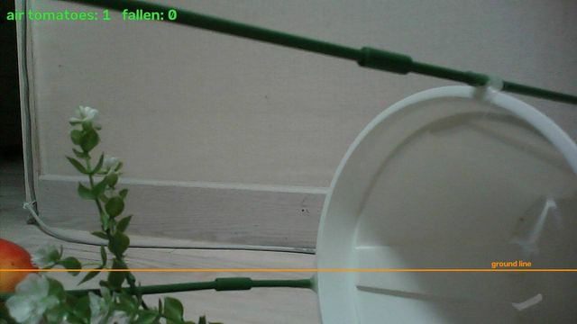 |  | 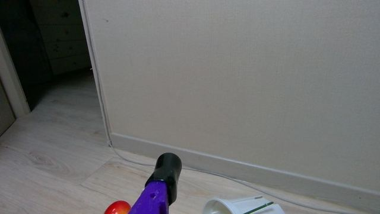 |
| --- | --- | --- |
| 앞 카메라: 옆으로 누운 흰 화분·가로 지지대, 열매는 왼쪽 아래(공중 1) | 같은 순간 Astra 깊이(발행기 원본 = **거울상**). 60cm 안 화분은 검게 비었다 | 손목 D405: 앞 벽, 왼쪽에 열린 문, 아래에 열매 |

**② 첫 둘러보기 — 왼쪽 84°에서 막힘 → 경계로 가다 오른쪽 벽에 붙음**

| 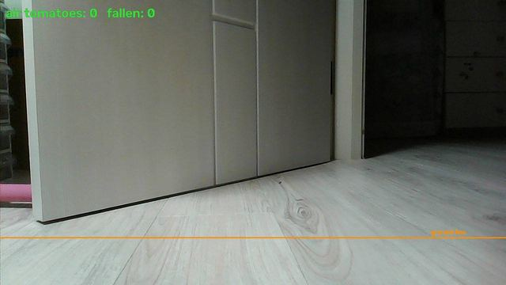 | 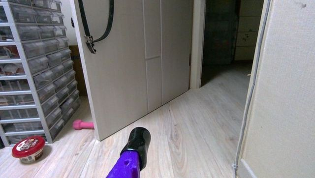 |
| --- | --- |
| 앞: 문짝과 문틈(큰방). 오른쪽 벽이 지도에 없던 채로 다가갔다 | 손목: 오른쪽이 벽에 바짝 — 왼쪽 회전 때 차체 뒤가 벽으로 휜다 |

**③ 두 번째 — 153° 돌다 선반 앞 60cm 안(깊이 4%), 양쪽 회전 막힘**

| 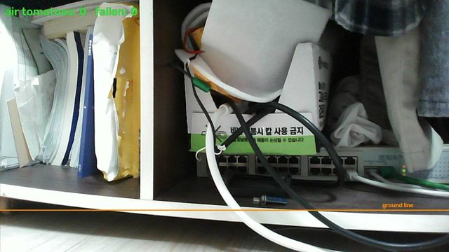 | 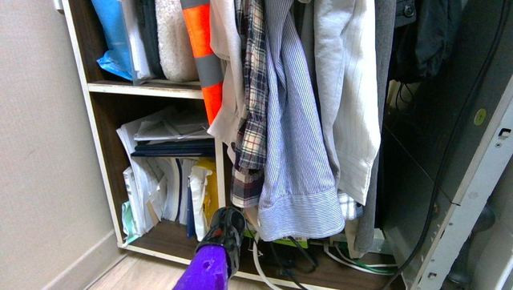 |
| --- | --- |
| 앞: 선반·전선·외투 — Astra가 투광기를 끄는 거리 | 손목: 걸린 옷이 화면을 채운다 |

**④ 트인 곳으로 — 전진 200·230은 안 움직이고(정지마찰), 255로 나가다 외투에 닿음**

| 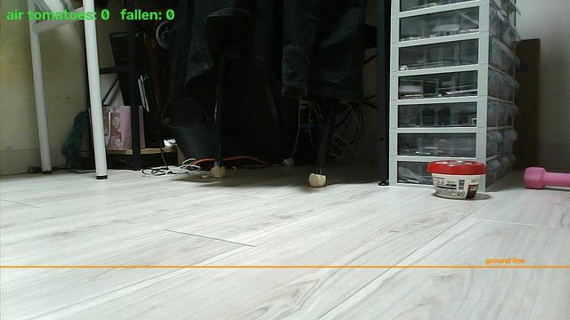 | 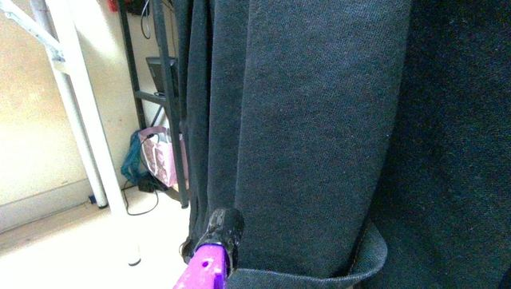 | 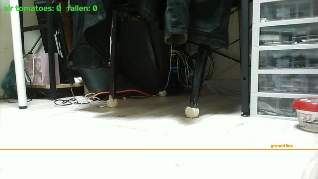 |
| --- | --- | --- |
| 앞이 트였는데 60걸음을 0.79m에서 맴돌았다(맞춤 잡음이 '움직였다'로 보임) | 255×1.2초로 나가다 **검은 외투**에 집게가 닿음 — 깊이에 안 잡힌다 | 물러난 뒤: 의자 다리·전선·외투 — 얇고 검은 것들 |

**⑤ 세 번째 — 128°에서 서랍장·멀티탭 앞, 양쪽 막힘**

| 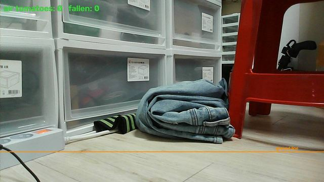 | 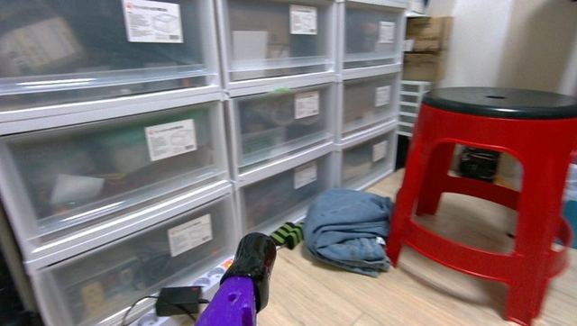 |
| --- | --- |
| 앞: 서랍장 앞 청바지·멀티탭, 오른쪽 빨간 의자 | 손목: 서랍장 정면 — 회전 지름 0.9m가 안 나온다 |

**⑥ 왜 쓰러진 나무가 지도에 없었나 — 깊이 화각(±29°) 밖이었다**

| 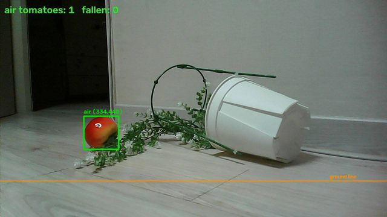 |  |
| --- | --- |
| 나무 쪽으로 돌린 앞 카메라: 화분·줄기·열매(공중 1, cx 334) | 같은 방향 Astra 깊이: 화분(0.6~0.77m)과 열매(≈0.9m)가 또렷 → 지도에 들어감 |

**⑦ 큰방으로 — 문틈과 그 앞에 누운 나무**

|  | 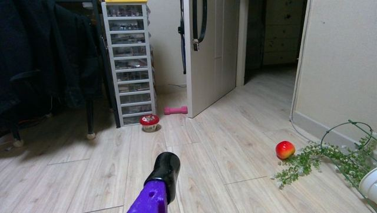 |
| --- | --- |
| 앞: 서랍장·덤벨·문짝, 오른쪽 끝에 열매(공중 1) | 손목: 열린 문짝 오른쪽이 큰방 문틈. 나무는 오른쪽 벽을 따라 누워 열매가 문틈 직선 위 |

| 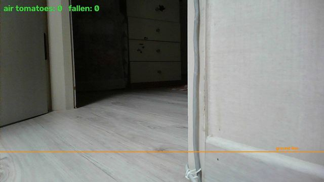 | 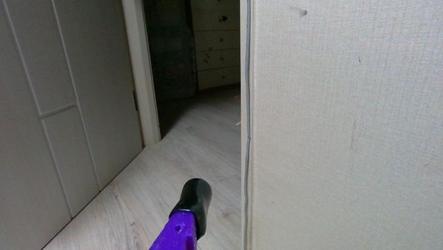 |
| --- | --- |
| 지도 길로 갔다가: 문틈 오른쪽 벽 모서리(전선)에 걸림 → 10걸음 무진척 정지 | 손목: 왼쪽 문짝, 오른쪽 벽 모서리 — 양옆 여유 ≈10cm |

| 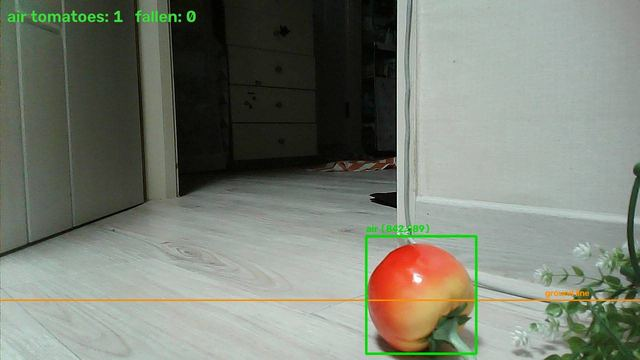 | 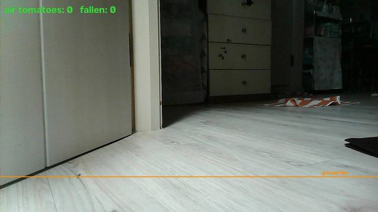 | 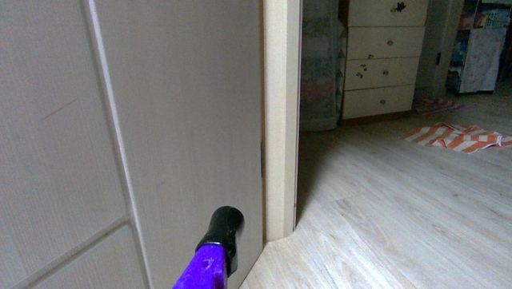 |
| --- | --- | --- |
| 다시 맞춘 뒤: 열매가 모서리 바로 앞 ≈0.5m(밀고 지나가기로 함) | 열매를 지나 문틈 안으로 — 앞에 큰방 | 손목: 왼쪽 문틀(경첩)이 바짝 — 전진마다 왼쪽으로 5~10° 쏠림 |

**⑧ 큰방 — 수건 위로 올라감 → 진한 색 바닥 찍기**

| 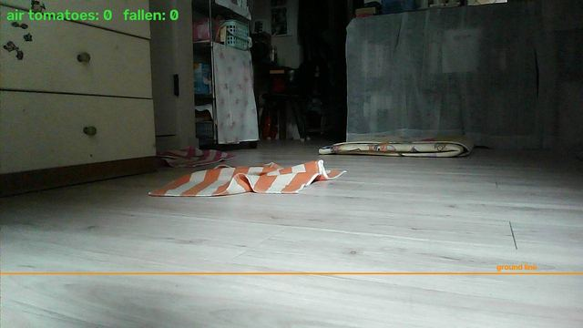 | 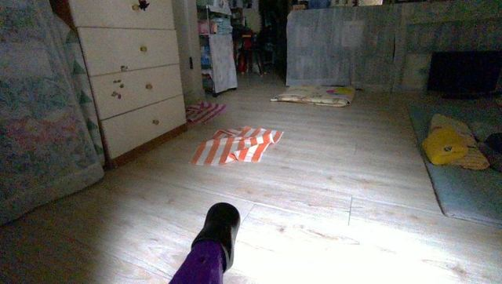 |
| --- | --- |
| 큰방 진입: 서랍장·수건·매트, 트인 마루 | 손목: 앞 수건 — 바닥 위 5cm 아래라 깊이 지도엔 없다 |

| 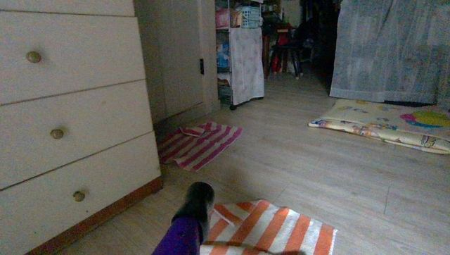 | 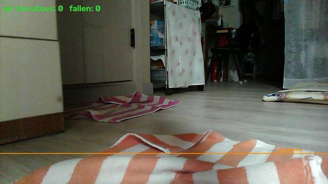 | 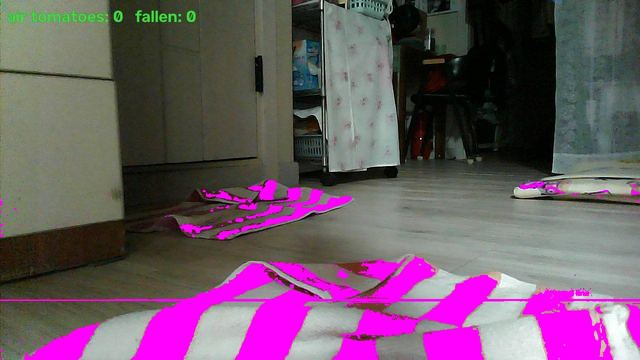 |
| --- | --- | --- |
| 수건 위로 올라간 자리(서랍장 앞) | 앞 카메라 바로 앞에 수건이 구겨져 있다 | 진한 색 바닥 판정(자홍) — 수건 줄무늬·매트만 잡히고 마루·그늘은 안 잡힘. 가로 주황선은 검출 주석이라 원본 프레임으로 바꿨다 |

**⑨ 큰방 첫 자리 — 여행가방·가방에 막혀 한 바퀴 실패**

| 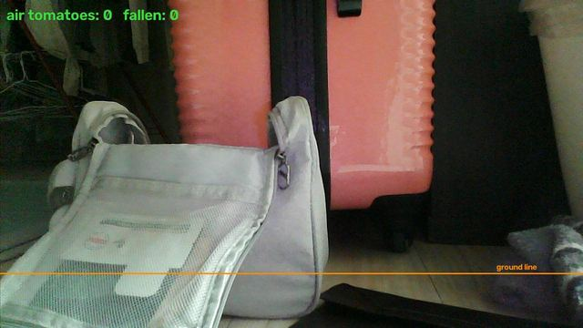 | 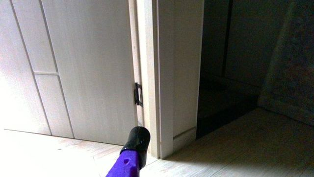 |
| --- | --- |
| 앞: 여행가방·가방 — 왼쪽 56°, 오른쪽 148°에서 멈춤 | 반대로 돌다 문틀 앞에서 멈춤 → 둘러보기가 스스로 '여기선 못 돈다'로 끝냄 |

**⑩ 깊이 화면이 '늘어나 보인' 이유 — 같은 순간 컬러와 깊이 원본**

| 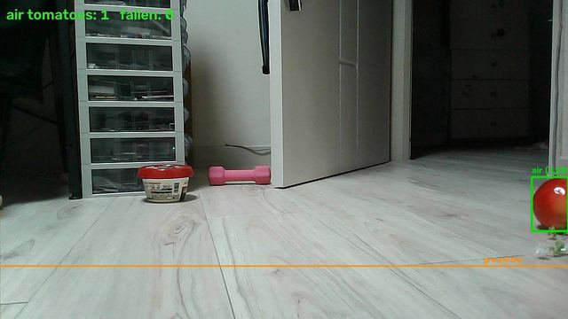 | 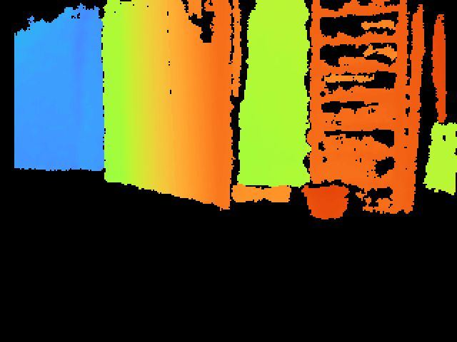 |
| --- | --- |
| 컬러 66°×40°(16:9): 왼쪽 서랍장, 가운데 문짝, 오른쪽 문틈 | 깊이 원본 58°×45°(4:3, 거울상): 서랍장이 오른쪽. 조작대는 좌우를 펴고 85.4% 폭으로 그린다 |

**⑪ 끝 — 작은 방으로 복귀, 젯슨 종료**

| 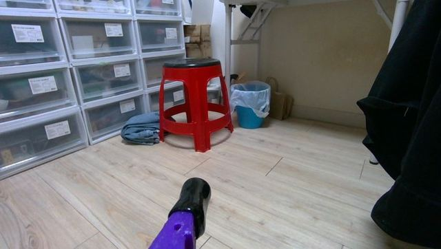 |
| --- |
| 작은 방 안, 빨간 의자 앞(회전판 기본 자리). 06:06 종료 |

## 3. 다음에 할 일

### 3.1 회전판 + 손목 D405 보정 (종이 필요 — 준비됨)
- [`docs/aruco/charuco_wall.pdf`](aruco/charuco_wall.pdf) 를 **A4 실제 크기 100%**로 뽑아 벽에(보드 가운데 바닥 위 30~40cm) 붙인다.
- 로봇을 그 앞에 세우고 회전판을 돌리며 같은 보드를 여러 각에서 본다 → 팔→차체 회전·평행이동을 다시 푼다 → `wrist_to_body`와 selftest ④를 새 규약으로.
- 그다음 둘러보기의 "제자리 한 바퀴"를 **"회전판으로 훑기"**로 바꾼다 — 차체를 안 돌리고 사방을 보니 좁은 집에서도 위치를 맞추고, 돌기 전에 옆에 닿을지 안다.

### 3.2 바닥 HOME (ArUco)
- [`docs/aruco/home_floor.pdf`](aruco/home_floor.pdf) — ID 49, 160mm, 화살표 = 출발 정면. 벽 보드(ID 0~16)와 안 겹치게 49로 했다.
- 바닥에 붙여 두면 앞 컬러로 보이는 순간 **절대 위치·방향을 cm 단위로 다시 잡는다**(쌓인 오차 0). 다음에 검출·지도 고정 코드를 붙인다.
- 둘 다 아래 100mm 눈금자로 인쇄 배율을 확인한다. 다시 만들기 = `python tools/aruco_print.py`.

### 3.3 엔코더 배선 → 거리 제어
1. JP1 3·4번 → D2·D3, JP2 3·4번 → D4·D6 점퍼(쉴드 VCC50 확인). 굴려서 `enc=` 카운트가 오르는지.
2. 젯슨에 PC판 `motor_link.py` 배포 → `T 2 1`·`T 3 1`로 부호 확인 → 전진 mm/카운트 측정.
3. `space_map`의 전진을 시간(255×1.2초) 대신 **카운트(`drive_ticks`)**로. 앞바퀴 둘(FL·FR)만이라 앞뒤만 — 옆걸음·회전은 IMU·지도.
- 장기: 엔코더 4개·전류·비상정지가 들어간 **STM32 보드**(`hardware_design/mecanum_stm32_pcb/`, 배선 완료·거버 전)로 옮긴다.

### 3.4 남은 약점
- 검은 천·얇은 다리는 깊이에도 색에도 안 잡힌다 → 앞 범퍼(스위치)가 가장 싸다.
- 수건 찍기는 **멈춘 뒤 장**에서만(가기·한 걸음) — 제자리 스캔 장은 아직 안 쓴다. 색 기준은 이 집 마루(채도 ≈12)에 맞췄다.
- 문틈 통과는 아직 사람이 한 걸음씩 봐야 했다(양옆 여유 ≈10cm, 지도 오차 5~10cm).

## 4. 쓰는 법 (새로 생긴 것)

- 조작대 **[🧭 방 둘러보기]** — 최대 6자리(API `rounds`≤20). 제외 구역은 API `avoid:"x0,x1,y0,y1;…"`(지도 좌표 m).
  권장 지령: 전진 **255 · 1.2초**(오늘 차체 기준).
- 웹 3D 지도: 끌기 = 돌리기 · **오른쪽 끌기 / Shift+끌기 / 두 손가락 = 옮기기** · 휠 = 확대 · **두 번 누르기 = 로봇으로**.
- 명령줄: `space_map.py explore --rounds 15 --vx 255 --vsecs 1.2 --avoid=-3,2.2,-1.1,3`
- 검증: `python ros2/tools/space_map.py selftest`(⑫ 경계·제외 구역, ⑬ 납작한 물건) ·
  `SIM_EXPLORE=4 python ros2/tools/space_map_sim.py imu 0`(가상 방: 바닥 87%→99~100%, 자세 오차 0.04m).

## 5. 상태

- 로봇: **작은 방 안**(문 안쪽 약 0.4m, 앞에 빨간 의자), 회전판 기본 자리. **젯슨 종료함**(06:06).
- 젯슨 지도 백업: `~/space_map-20261030-backup.npz`(10/30) · `~/space_map-20261105-slid.npz`(미끄러진 지도). 지금 지도는 오늘 큰방까지 담은 것.
- `ros_selfcheck` 590종 중 2종 실패는 오늘 전부터 있던 것(케이스 받침 구멍 실측·남의 파일 CRLF).
