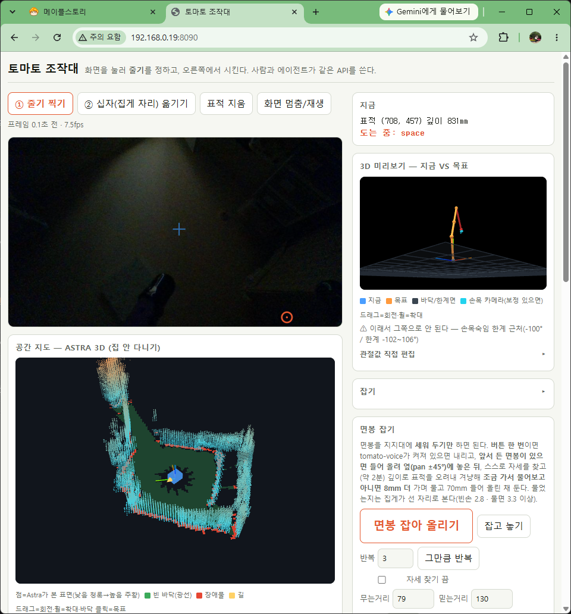
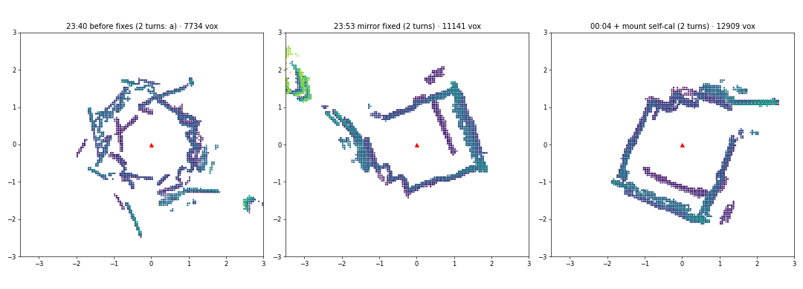
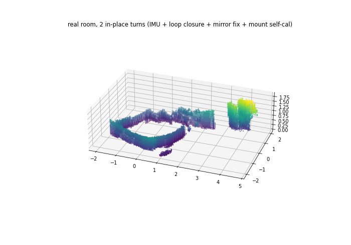
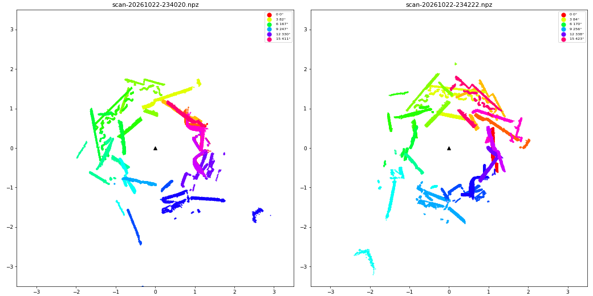
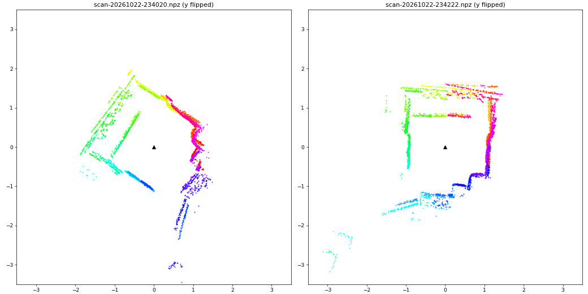
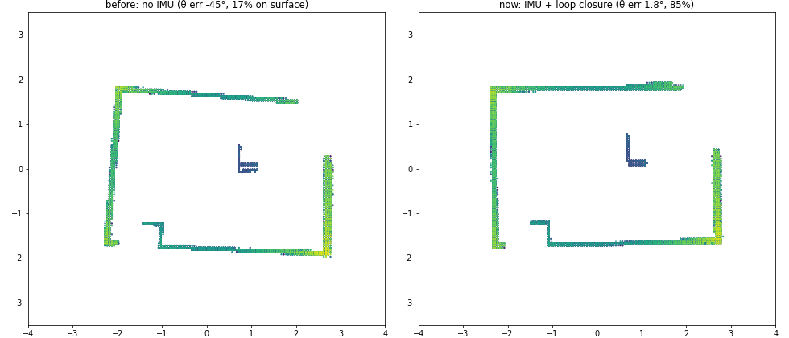
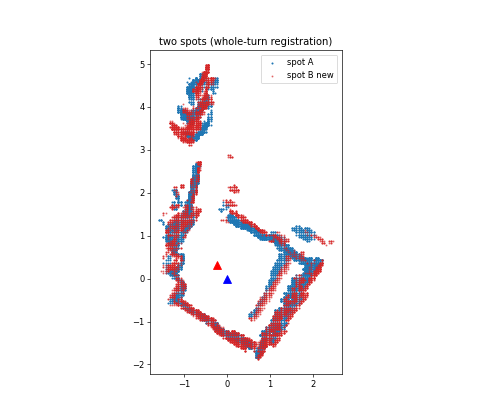
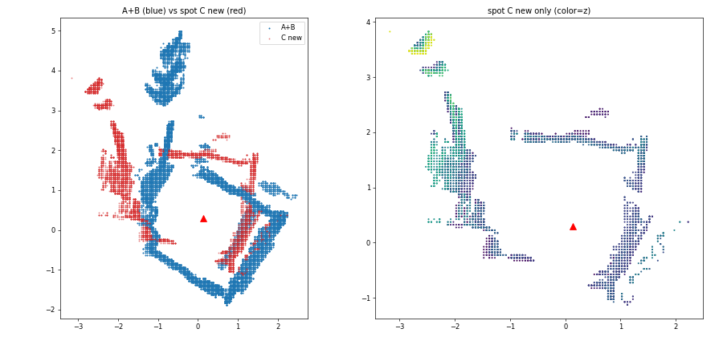

# 차체 IMU · 회전 공간 지도 개발 보고서 (2026-10-22 19:20 ~ 10-23 02:00)

목표(10/22 19:20 지시): **차체 회전량을 스스로 재고 표시해서, 차체를 돌려 찍은 공간이 3D로 제대로 나오게 한다.**

결론: **달성.** 차체가 제자리에서 한 바퀴 돌며 찍은 실제 방이 3D로 닫힌 모양으로 나오고, 같은 자리에서 두 번 찍으면
새로 생긴 점의 **80%가 첫 지도 8cm 안**(12cm 안 95%)에 떨어진다. 시작할 때는 **27%**였다.
한 자리를 옮겨 다시 찍어도 **60%(8cm)·91%(20cm)**로 맞물린다. 세 번째 자리는 실패했다(§5).

---

## 1. 조작대 화면 (10/23 01:50 무렵, 사용자 촬영)

- 아래 **공간 지도 카드**에 방 둘레 벽(청록 점)과 장애물(빨강), 빈 바닥(초록)이 닫힌 사각형으로 보인다.
  가운데 파란 상자가 차체, 노란 원뿔이 앞이다. 카드 아래 줄에 **IMU 누적 회전·각속도·정지 여부**가 실시간으로 뜬다.
- 위 손목 카메라 화면이 어두운 것은 **방 불이 꺼져 있어서**다. Astra 깊이는 적외선 투광기로 재므로 지도에는
  영향이 없다. 컬러를 쓰는 기능(토마토 검출, 손목 카메라 겨냥)은 어두우면 안 된다.
- 오른쪽 위 "도는 중: space"는 이 화면을 찍을 때 마지막 정리용 스캔이 돌고 있었다는 뜻이다(§7).

## 2. 무엇을 만들었나

| 부분 | 내용 | 파일 |
|---|---|---|
| 차체 IMU | MPU6050을 젯슨 40핀 I²C(버스 7, 0x68)에 연결. 205Hz로 읽어 회전량을 `/dev/shm/imu.json`에 발행(systemd `imu-yaw`, 부팅 자동 실행) | `tools/imu_yaw.py`, `deploy/imu-yaw.service` |
| 회전 넛지 | 시간이 아니라 **IMU 각도로 끊는다**. 안 돌면 지령을 0.5초마다 +30씩 올려 정지마찰을 넘는다 | `space_map.turn()` |
| 제자리 한 바퀴 스캔 | 걸음마다 맞추지 않고 θ=IMU로 장을 모은 뒤, 한 바퀴 뒤 같은 곳을 다시 본 장으로 **고리 닫기(점구름 ICP)** → IMU 스케일을 재고 다시 짓는다 | `scan_imu`, `close_and_build` |
| 손으로 돌리며 스캔 | 모터 없이 사람이 15~20°씩 돌리면 IMU가 멈출 때마다 한 장씩 담는다 | 조작대 버튼 |
| 새 자리 맞춤 | 다른 자리에서는 **한 바퀴(360°)를 통째로** 기존 지도에 맞춘다 | `register` |
| 자기 보정 | 기록한 한 바퀴들로 Astra 장착값(회전 중심 기준)을 찾는다 | `space_map.py selfcal 기록…` |
| 기록·재현 | 한 바퀴의 장을 `~/space_scans/`에 남기고 PC에서 `replay` | `record`, `replay` |
| 모의 실행기 | 가짜 방·차체·IMU로 실기 코드를 그대로 돌려 지도 품질을 잰다(PC, 40초) | `ros2/tools/space_map_sim.py` |
| 조작대 | `/imu` + 실시간 회전량 줄, 3D 차체가 IMU 회전을 따라 돈다 | `click_server.py` |
| 계획 문서 | 엔코더를 못 읽는 이유(쉴드 회로도), 브라운아웃 원인, STM32 자세 보드 목표 | `docs/stm32-자세보드-목표.md` |

## 3. 실제로 지도를 망치고 있던 것들 (찾은 순서)

같은 자리 두 바퀴 일관성 = 두 번째 바퀴가 새로 만든 복셀 중 첫 지도 8cm 안에 든 비율.

| # | 원인 | 증상 | 고침 | 일관성 |
|---|---|---|---|---|
| — | (시작) | | | 27% |
| 1 | `base_nudge.open_link()`가 튜닝을 안 밀었다 | 브라운아웃으로 보드가 리셋되면 듀티 상한이 49%로 떨어져 **255로도 안 돈다**. "한 바퀴 돌고 나면 모터가 죽는다"로 보였다 | `JetsonBase`로 연다. 정지마찰 문턱이 **약 90**으로 내려가고 리셋 0회 | 42% |
| 2 | **Astra 깊이 영상이 거울상** | 장들을 겹치면 벽이 부채꼴로 엇갈렸다 | meta에 `mirrored: true`, 3D로 펼 때 좌우를 뒤집는다 | 52% |
| 3 | 장착값이 CAD 추정(렌즈가 회전 중심 앞 12cm) | 오른쪽 벽이 두 겹 | **자기 보정: x 0.345m · y −0.10m**(메카넘이 실제로 도는 축 기준). 한 바퀴로 맞춘 값을 다른 바퀴에 써도 개선돼 과적합이 아니다 | **80%** |

그 밖에 고친 것:
- **I²C 깨진 샘플**: 샘플 하나가 1.25°씩 계단을 만들었다(5분에 −8.6°). 한 트랜잭션 읽기와 튐 거르기로 0회.
- **기어가는 회전을 삼킴**: 정지마찰 근처에서 0.5°/s로 기어가는 회전을 "정지"로 보고 버렸다(모의에서 4°가 0°로). 정지 판정을 좁히고, 온도로 영점이 옮겨 가면 다시 잡게 했다. 실제로 z축 영점이 −1.03에서 −1.35°/s로 옮겨 가 있었다.
- **조리개 미끄럼**: 맞춤이 처음 보는 쪽 벽 점을 아는 벽에 얹으려고 걸음마다 15cm씩 미끄러졌다. 잡음 0, θ 정확인 모의에서도 그랬다. 모르는 칸 점을 빼서 고쳤다.
- **`/dev/shm` 파일이 사라짐**: SSH가 끊길 때 logind가 지우는 것으로 보인다. IMU 발행기가 죽던 것을 견디게 했다.
- **고리 닫기 판정**: 흩어진 추정을 그대로 써서 400°에 12°를 비튼 적이 있다. 서로 맞는 무리가 있을 때만 쓴다.

### 진행 단계별 실기 지도 (같은 자리, 두 바퀴씩)

왼쪽부터 수정 전(엉킨 고리) → 거울상 수정 후(방 모양이 드러남, 오른쪽 벽 두 겹) → 장착값 보정 후(벽이 한 겹으로 닫힘).

### 거울상 발견 — 같은 기록, 좌우만 뒤집었을 때

| 그대로 | 좌우 뒤집음 |
|---|---|
|  |  |

장마다 색이 다르다. 왼쪽은 벽 선분이 부채꼴로 엇갈리고, 오른쪽은 곧은 직사각형 방이 된다.

## 4. 수치

**모의**(가짜 방, 깊이 잡음·미끄럼·IMU 스케일 2~3% 오차; 복셀이 참 표면 7.5cm 안에 든 비율)

| 방식 | 복셀 | 끝 θ 오차 |
|---|---|---|
| IMU 없음(예전 코드) | 17% | −45° |
| 걸음마다 맞춤 + IMU 짐작 | 37~43% | 0~2° |
| **IMU + 고리 닫기(ICP), 지금** | **81~93%** | **≤1.8°** |
| 참 자세(천장) | 97% | 0 |

**실기**

| 항목 | 값 |
|---|---|
| 한 바퀴 | 16~21걸음, 90~220초(정지마찰 재시도에 따라 다름) |
| 같은 자리 두 바퀴 일관성 | 27% → 42% → 52% → **80%**(8cm) / 95%(12cm) / 99%(20cm) |
| 두 자리(0.5m 이동) 일관성 | 28%(한 장으로 시작 자리를 잡던 때) → **60%**(8cm) / 91%(20cm) |
| IMU 정지 표류 | 시간당 1.4~2.4° |
| IMU 스케일 | 이 칩은 회전을 약 1.7% 덜 잰다 → `IMU_SCALE=1.017`. 바퀴마다 고리 닫기가 남은 0~1.5%를 잰다 |

파랑 = 첫 자리, 빨강 = 0.5m 옮긴 자리에서 새로 생긴 점. 같은 벽 위에 얹힌다.

## 5. 안 된 것

1. **세 번째 자리는 실패했다.** 그 자리 지도는 그 자체로는 깔끔하지만 기존 지도에 대해 약 25° 돌아가 있다.
   θ를 ±40° 범위에서 찾아도 맞는 곳이 뚜렷하지 않았다. 그 자리에서는 **전진 지령마다 IMU가 +26~30° 회전을 쟀다**.
   바퀴가 걸리거나 바닥이 미끄러워 전진이 회전으로 바뀐 것으로 보인다. 이제 목표로 가기는 이런 일이 두 번 연달아
   나면 멈춘다. 진짜 회전인지 진동으로 생긴 거짓 회전인지는 바깥 카메라로 한 번 봐야 가려진다.
   
2. **브라운아웃은 아직 남아 있다.** 7.8V 공급에서 모터를 세게 밀면 주행 보드가 리셋된다. 튜닝 재적용으로
   주행은 이어지지만 근본 해결은 아니다(공급 9~10V 또는 로직 5V 분리 — `docs/stm32-자세보드-목표.md`).
3. **카메라 yaw는 제자리 회전으로는 거의 안 보인다.** ±3°를 줘도 겹침이 거의 같아서 0으로 둔다.
4. **먼 점(3m 넘게)은 깊이 잡음으로 벽 뒤에 번진다**(모의에서 확인).
5. **Astra 손-눈 보정(`cameras.astra`)은 거울상 점으로 푼 것**이라 다시 풀어야 한다(팔·사람 필요).

## 6. 다음 할 일

| 순서 | 일 | 누가 |
|---|---|---|
| 1 | 세 번째 자리 바닥·바퀴 확인(매트·케이블 걸림?), 바깥 카메라로 전진 중 실제 회전 확인 | 사람 |
| 2 | 주행 전원: 공급 9~10V 또는 로직 5V 분리(브라운아웃) | 사람 |
| 3 | Astra 손-눈 보정을 거울상 수정 뒤 점으로 다시 풀기 | 사람 + 팔 |
| 4 | 먼 점 가중(거리별)으로 벽 두께 줄이기 | 소프트웨어 |
| 5 | 세 자리 이상 이어 다니며 표류가 쌓이는지(지금은 자리 간 고리 닫기 없음) | 소프트웨어 + 실기 |

## 7. 마무리 상태

- 02:00 무렵부터 **젯슨에 원격으로 닿지 않는다**(SSH·HTTP 모두 시간 초과, ping 50% 손실). 마지막 정리용 스캔
  (지도를 지우고 지금 자리에서 한 바퀴)은 사용자 화면에 "도는 중"으로 보였고, 끝났는지는 확인하지 못했다.
  와이파이가 약해졌거나 젯슨이 바쁜 상태로 보인다. 연결되면 할 일:
  임시 파일(`/tmp/imu_*`) 지우기, 실험용 지도 사본(`~/space_map.[a-t].npz`)을 한 폴더로 모으기, 서비스 상태 확인.
- 젯슨에 남아 있는 것: `imu-yaw` 서비스(부팅 자동), `~/space_mount.json`(x 0.345·y −0.10), `IMU_SCALE=1.017`,
  실기 기록 `~/space_scans/scan-*.npz`, 이전 지도 백업 `~/space_map.backup-*.npz`.
- 진행 기록·함정·근거 = `docs/개발일지-2026-10-22-IMU.md`, 사용법·한계 = `docs/space-map.md`.

## 8. 커밋 (브랜치 `feat/base-firmware-v2-and-arm-presets`, 모두 푸시)

317ac51 IMU 연동 · d601f34 정지마찰 램프 · d2c5cc1 조리개 수정·고리 닫기·모의 실행기 · 453de93 손 스캔 ·
d599cec 자리 어긋남 보고 · b1a165b 목표로 가기 모의 · 1411354 고리 닫기 판정 · 7e81833 ICP 고리 닫기 ·
990f0f9 기록·replay · **b1e20ec 근본 원인 둘(튜닝·거울상)** · ff861cc 장착값 y·yaw · e5bb8b2 selfcal ·
88e72aa IMU 기어가기 · df90354 새 자리 통째 맞춤 · 90b7726 θ 탐색 폭 · 785f689 전진→회전 감지
