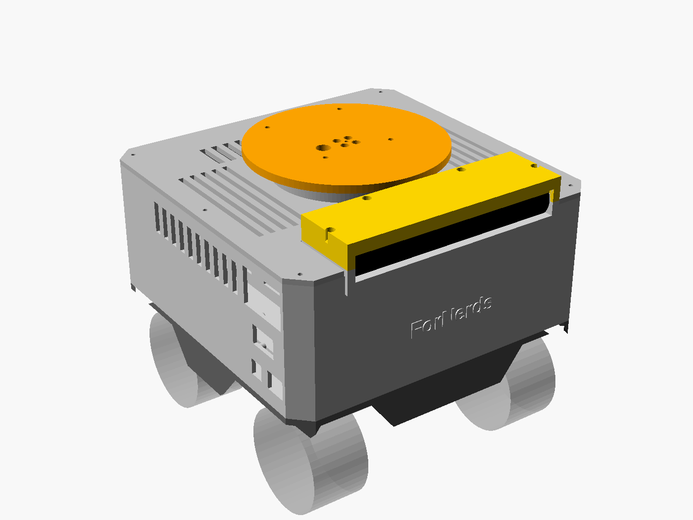
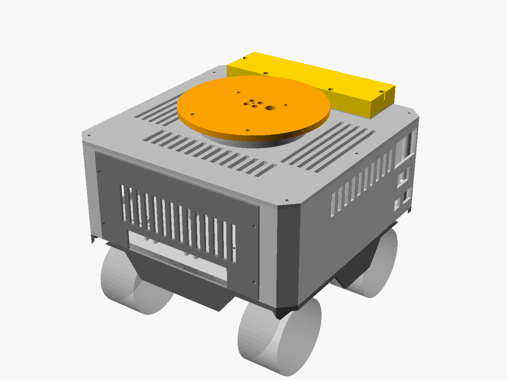
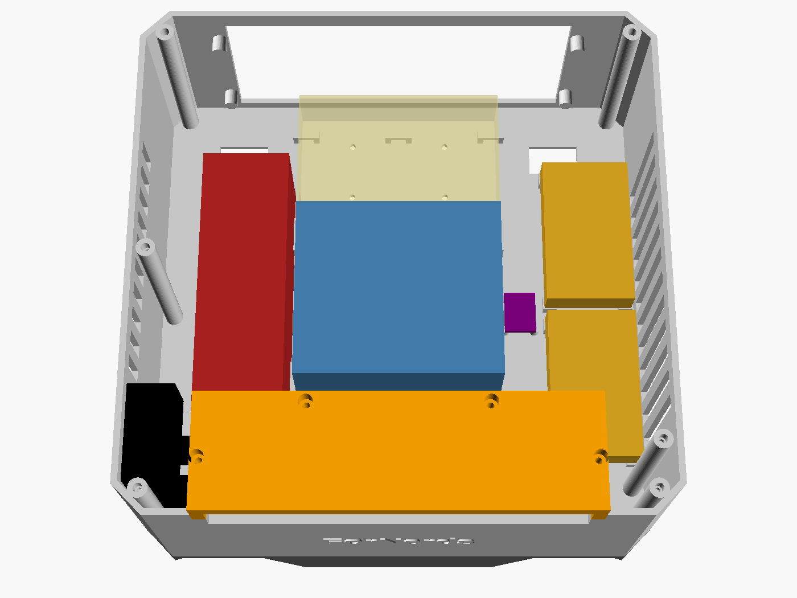

# 케이스 v2 (넓은 몸통 + 각진 바퀴 여유 + 180° 회전판)

원본 = [`tomato_case.scad`](tomato_case.scad) (OpenSCAD 2021.01). 스케치 = [`case-sketch-2026-11-05.png`](../../docs/design/case-sketch-2026-11-05.png). 치수 출처 = [`3D-parts-mapping.md`](../../docs/design/3D-parts-mapping.md).
옛 판(폭 151.9, 젯슨 밑 벅부스트)은 git 이력에 있고 지금 로봇에 달려 있다. **아직 출력 전이다.**

**조립도** = [`case-assembly-guide.html`](../../docs/design/case-assembly-guide.html)(v2, 17단계·분해도·출력물·나사). scad를 고치면 `python hardware_design/case/make_assembly.py`로 다시 만든다(`part="step"` 장면을 OpenSCAD로 뽑는다, 10초).
⚠ `case-render-*.png`는 옛 판 기준이다.

## 구조 — 몸통 252 × 250 × 104 (상판 위 회전판 윗면까지 141)
| 부품 | 무엇 |
|---|---|
| `tray` | 몸통. 바닥이 체결 패턴 두 벌을 받는다. 앞 윗면에 Astra 크래들 |
| `lid` | 베어링 받침·서보 걸이(옛 판과 같은 치수), 환기. 앞은 크래들을 ㄷ자로 비킨다 |
| `riser` ×2 | 받침 기둥 15mm. 패턴 하나에 블록 하나, 나사 4개 |
| `skirt` | 바닥 밑 둘레 30mm, 바퀴 자리는 사다리꼴로 판다. **없어도 동작한다**(배선 가림·겉모습) |
| `rear_cover` | 떼는 뒷벽. 아래쪽 120×16이 케이블 출구 |
| `astra_cap` | 크래들 캡. **새로 뽑는다** — 2026-11-09 크래들을 앞벽과 한 면으로 옮기고, 본체 모양(앞뒤는 곧고 좌우 끝만 둥글다)을 바로잡고, 나사 4개를 양 끝벽(9)으로 모았다. 옛 캡은 안 맞는다 |
| `platform` · `clamp` | **그대로** — 지금 달린 것을 옮겨 단다 |

## 안쪽 배치
| 자리 | 무엇 | 왜 |
|---|---|---|
| 정중앙 | 젯슨(받침 12mm), 위 18mm 띄워 회전 서보 | 밑으로 선이 지나고, 벅부스트를 밑에서 뺐다 |
| 뒤 | **비움 — USB 칸 76mm**, 뒷벽은 떼는 판 | 젯슨 단자가 이쪽. 뚜껑을 안 열고 손이 들어간다 |
| 왼쪽 | 배터리 세움(긴 쪽 앞뒤), 왼벽과 25 띄움 | 선·벨크로 자리 |
| 왼벽 앞 | 전압계 창 · OLED 창 · 로커 스위치 · DC 충전 잭 | 패널 몸통이 배터리 앞(y<56)에 들어간다 |
| 오른쪽 | 벅부스트 2장, 긴 쪽 앞뒤로 나란히 | 위아래가 트였다. 오른벽 전 높이 환기 |
| 젯슨↔벅부스트 틈 | IMU MPU6050, M2 보스 2개 | 몸통 앞뒤 가운데, 위에서 손이 닿는다 |
| 앞 가운데 | 제어 기판 100×70 | **Uno 구멍 그대로**라 Uno와 STM32 보드가 같은 보스에 앉는다. 젯슨과 0.25 간격 |
| 앞-오른쪽 | 예비 M3 보스 4개(20mm 격자) | 전류 센서·단자대·추가 보드 |

## 설계 판단 (바꾸기 전에 읽을 것)
- **바퀴는 상판 밑에 있다**(`전체 외관.pdf` 18쪽) — 바닥은 원래 안 닿는다. 치마만 상판 옆으로 내려가므로 거기를 판다.
- **간섭 검사** = `part="clash"`(부품·내용물 교집합). 2026-11-05 결과는 기판·보드가 보스에 얹히는 접촉면 16곳뿐, 두께 있는 겹침 0. 치수를 바꾸면 다시 돌린다.
- **무게 중심이 왼쪽으로 쏠린다** — 배터리(≈560g, 추정)가 가운데서 ≈76mm 왼쪽이라 벅부스트·기판을 빼도 차체 전체로 ≈10mm(추정, 전체 3.5kg 가정). 메카넘은 하중이 치우치면 직진이 틀어질 수 있으니 실기에서 보고, 필요하면 오른쪽 예비 칸에 추를 얹는다.
- **조립 후 다시 잴 것**: 회전판이 상판 기준 **45mm 올라가고 4.8mm 앞으로** 온다. Astra도 45mm 올라가고 3mm 뒤로 간다 → `~/space_mount.json`(`space_map selfcal`), `cameras.astra` 보정, 대기 자세·잡기 시작 자세의 높이를 다시 본다. 손목 D405(`on_arm`)는 팔과 같이 움직여 안 바뀐다.
- **OLED + 전류 센서를 권한다** — SSD1306 0.96"(I²C 0x3C)와 INA226 모듈(0x40)을 MPU6050과 같은 젯슨 I²C 버스 7(0x68)에 물리면 주소가 안 겹친다. 전압계는 눈으로 볼 뿐이지만 INA226이면 **배터리 전압·전류를 소프트웨어가 읽는다**(11/05 주행 저하 때 없어서 원인을 못 가렸다). OLED엔 전압·IP·상태를 띄운다. 코드는 아직 없다.
- **배선은 중심을 못 지난다** — 서보 축이 중심에 있다. 뚜껑의 180° 호형 슬롯(−X)을 따라 회전판 구멍이 함께 돈다. 슬롯 밑은 젯슨 위 18mm 칸이다.
- **젯슨은 나사로 안 박는다** — WiFi 안테나 버전은 캐리어 보드에 고정 구멍이 없다. 좌우 레일 + 네 모서리 턱(여유 0.5). 뒤쪽 턱은 단자를 안 막게 2mm만 올렸다.

### 옛 판의 간섭 검사 기록 (2026-10-03 — 회전판 쪽은 그대로 유효)
- 스토퍼 핀·홈은 **−X**(`stop_deg=180`) — +X면 핀이 서보 윗면을 파고든다. 누름 링 나사머리는 회전판 밑 R49~57 홈으로 비킨다. 가운데에서 팔이 앞을 보도록 `so101_holes`는 앞 쌍 −15, 뒤 쌍 +55.

## 회전 베어링 = 6816-2RS (80 × 100 × 10, 얇은 깊은홈) — 2026-09-26 구매
레이지수잔은 기울기 유격이 커서 뺐다(팔 끝 30cm에서 0.5°면 ~2.6mm). 5.5인치 제품은 안지름 64라 안쪽에 들어갈 자리도 없었다.

**두 링을 위아래 모두 붙잡는다** — 끼움만으로는 팔을 뻗을 때 한쪽이 들린다(0.9kg×20cm ÷ Ø90 ≈ 양쪽 20N).
| 링 | 아래 | 위 |
|---|---|---|
| 바깥 링 | 뚜껑 받침 턱(높이 3) | 누름 링 `clamp` (두께 2, M3×12 셀프탭 4개 — 회전판 올리기 **전에** 조인다) |
| 안쪽 링 | 허브 끝 **스냅 걸쇠**(0.5 턱, 세로 홈 6개로 휜다 — 밀어 넣으면 딸깍) | 회전판 턱(높이 3) |

- 뚜껑 윗면 → 회전판 밑면 = 16. 서보를 뚜껑 판 속으로 3 올리고(포켓) 회전판 위에서 혼 나사머리를 3 묻어 **혼 나사 M3×20**(연결 기둥 12.7).
- 안쪽 배치(반지름): 혼 구멍 11.5 · 배선 슬롯 14~26 · 스토퍼 홈 29~35 · 허브 벽 37~40. 살은 모두 2.5mm 이상.
- **조립 순서**: ① 서보를 뚜껑 밑 걸이에 ② 베어링을 받침에 눌러 넣고 누름 링 조임 ③ 혼을 서보에 ④ 회전판 허브를 안쪽 링에 밀어 넣어 걸쇠를 채움 — 이때 스토퍼 핀이 홈에 들어가게, 서보는 중앙(2048) ⑤ 혼 나사 4개를 위에서.
- **끼움 공차는 프린터마다 다르다** → `part="fit_test"`(받침 +0.0/+0.2/+0.4, 허브 −0.2/−0.1/0.0, 돌기 수 = 순번)를 먼저 뽑아
  베어링을 끼워 보고, 손으로 꽉 눌러 들어가는 것을 `brg_fit_od`·`brg_fit_id`에 넣는다.
- SO-101 볼트 구멍(반지름 42)이 베어링 바로 위다 → 회전판에 **M3 열압입 인서트**를 박고, 나사는 판(6)을 넘지 않는 길이로.

## 회전 서보 = STS3215 C018 (12V · 1/345 · 30kg·cm) — 팔과 같은 것 (2026-09-26 구매)
외형도([제조사](https://www.feetechrc.com/525603.html)): 몸체 45.23×24.73×35 · 출력축은 몸체 중심에서 12.5(가까운 끝에서 10.1) ·
25T 스플라인(외경 5.9, 윗면 위 3.4) · 원판 혼 Ø19.95, **M3 4개 / 볼트원 14**, 가운데 M3 고정 나사.
| 따져 본 것 | 값 | 판단 |
|---|---|---|
| 무게 | 베어링이 받는다 | 서보는 돌리기만 |
| 가속 토크 | 팔 ~0.9kg·무게중심 15cm → 관성 ~0.025kg·m², 0.2초에 가속하면 ~6kg·cm | 30kg·cm로 5배 여유 |
| 되받는 토크 | 팔의 어깨(pan) 서보가 휘두를 때 반작용이 회전판에 온다 — 최대 그 서보의 스톨 30kg·cm | **같은 서보라야 비긴다** (더 약하면 판이 밀린다) |
| 백래시 | 실측 ~0.87° (스펙 ≤0.5°) → 팔 끝 30cm에서 **~4.6mm** | 손-눈 15mm 예산 안. 출력축 자기 엔코더라 **읽은 각은 진짜 각** — TF는 읽은 값으로 |
| 분해능 | 0.088°/틱 → 30cm에서 0.46mm | 충분 |
| 배선·전원 | 팔 버스에 **ID 7**로 한 줄 더, 팔 12V 레일 공유 | 새 드라이버·새 전원 없음. 12V 벅부스트 용량을 7개 기준(스톨 2.7A)으로 확인 |

- 감속기(프린트 기어)는 넣지 않는다 — 기어 유격이 서보 백래시에 더해진다. 판이 밀리는 게 실측되면 그때 3:1.
- ⚠ **0/4095 경계를 180° 구간 밖에 두라** — wrist_roll에서 엔코더 경계가 가동구간에 걸려 팔이 튀었다
  (메모리 wrist-roll-wrap-fix). 조립 전에 중앙(2048)을 회전판 정면에 맞춰 영점을 쓴다.
- **실기 설정 (2026-10-22)** — 서보 EEPROM에 써 둠, 바꾸면 여기도 고친다:
  - ID 1(공장값) → **7**. 공장값 그대로 버스에 물리면 어깨 pan(ID 1)과 충돌해 둘 다 안 읽힌다
    (핑 20번에 1번 응답) — ID는 **회전 서보만 단독으로** 물려서 바꾼다(둘 다 물린 채 쓰면 둘 다 7이 된다).
  - 정면 = **2048**(Homing_Offset 1690, 사용자가 정면에 맞춘 자리 — 신뢰 기준). 경계 0/4095는 뒤쪽 180°.
  - 손으로 잰 끝: raw 581(왼쪽 +129°, 여유 있음) · raw 3138(오른쪽 −96°, 끝). **Min/Max_Position_Limit = 1024/3072 (±90°)**.
  - **raw가 늘면 위에서 봐 시계방향(오른쪽)** — 소프트웨어 각은 pan과 같게 왼쪽 +라 부호를 뒤집는다(`follower_io._YAW_SIGN`).
  - ⚠ **2048(사용자가 정한 '정면')의 팔은 주행 정면(Astra 쪽)이 아니라 차체 오른쪽 ≈−90°를 본다**(2026-10-23 손목 화면 9각도 실측, docs/작업판-2026-10-23.md). 주행 정면은 회전판 ≈+90°(한계 끝).
  - ⚠ **스토퍼 핀은 조립 전에 부러져 없다** — 기계식 멈춤이 없으므로 서보 한계(EEPROM)가 유일한 하드 리밋이다.
- 출처: [RobotShop STS3215 12V 30kg](https://www.robotshop.com/products/feetech-12v-30kgcm-magnetic-encoding-servo-sts3215) ·
  [Robo9 백래시·반복정밀도 실측](https://robonine.com/testing-of-feetech-sts3215-servomotor-backlash-repeatability-and-torque/)

## Astra Pro 전면 크래들 (2026-09-29) — 라인주행(바닥 카메라)은 뺐다
- **규격(넷, 2026-11-09)** — [Astra Pro 데이터시트 v1.2](https://www.mybotshop.de/Datasheet/Orbbec_Astra_Pro_Final.pdf): 165 × 30 × 40, 깊이 FOV H60° V49.5°(대각 73°), 0.6~8 m(최적 0.6~5), 0~40 ℃, USB 2.0 < 2.4 W, 마이크 2.
  [Orbbec Astra 시리즈 페이지](https://www.orbbec.com/products/structured-light-camera/astra-series/): 165 × **48** × 40(접은 받침대 포함), **310 g**, 밑 나사 **M6**(깊이 7.2, [포럼 공식 답변](https://3dclub.orbbec3d.com/t/i-would-like-to-know-the-kind-of-the-screw-hole-of-the-astropro/1319)), 깊이 FOV H58.4° V45.5°.
  ⚠ 1/4"-20은 **받침대 밑**이고 본체 밑은 M6다. 받침대 두께는 공식 48−30 = 18, 실측 14 — 4 차이는 기판 스택 여유(35)에 묻힌다.
  앞 턱 5mm가 세로 시야를 가리는지 scad가 검사한다(`astra_fov`).
- **본체 모양** — 앞(렌즈 면)·뒤·위·아래는 평면이고 **좌우 끝만 반원**(반지름 15, `astra_end_r`)이다. 11/09 전 판은 앞뒤 모서리를 둥글려 캡 안쪽이 반원 홈이었다(사용자 지적).
- **본체를 트레이 앞 윗면 홈에 눕혀 끼우고 캡을 M3 4개로 조인다.** 접이식 받침대의
  틸트는 힘이 약해 안 쓴다(사용자). 본체 중심은 트레이 윗면 +5(Z 105). 렌즈 띠 앞은 위아래 턱 5mm만 남기고 연다.
- v2: 크래들이 몸통 폭 안에 들어가고, **크래들 앞면이 앞벽과 한 면**이다(렌즈 면은 벽 안쪽, y=3). 2026-11-09 사진 확인 — 옛 판은 크래들(177.6)이 몸통(158)보다 넓어 양옆 10mm씩 튀어나오고 앞으로도 3 나왔다. 뒷벽은 6(끝벽과 같다).
- **접이식 받침대(60×23, 접으면 본체 밑으로 14)는 분리가 안 된다** → 접은 채 크래들 바닥의 62×26 관통 구멍으로 트레이 안에 들어간다.
  받침대 밑 Z 76, 기판 스택 위 Z 41 → 35mm 여유. 케이블도 이 구멍으로.
- `astra_tilt`로 홈과 캡이 같이 기운다 — 무대가 높으면 5~10°.
- 회전판의 Orbbec 1/4" 자리는 뺐다(Astra는 차체 고정, D405는 손목).
- ⚠ 카메라가 차체에 고정이라 손-눈 보정은 `fixed` 식. `~/arm_eye.json`의 `cameras.astra`는 옛 자리 값이므로 **조립 후 재보정**.

## 나사·인서트 (v2)
| 자리 | 나사 | 개수 | 받는 쪽 |
|---|---|---|---|
| 상판 ↔ 기둥 ↔ 바닥 | **M3×25 + 너트** (새로 필요) | 8 | 바닥 안쪽 너트. 상판 3 + 기둥 15 + 바닥 3 |
| 뚜껑 ↔ 기둥 | M3×12 | 6 | 기둥 위 **인서트** |
| 치마 ↔ 기둥 | M3×12 | 6 | 기둥 아래 **인서트** |
| 뒷벽 판 ↔ 보스 | M3×12 | 4 | 셀프탭 |
| 서보 혼 ↔ 회전판 | M3×20 | 4 | 혼의 M3 암나사 |
| Astra 캡 ↔ 크래들 | M3×20 | 4 | 크래들 셀프탭 10. 양 끝벽에 2개씩 |
| 누름 링 ↔ 베어링 받침 | M3×12 | 4 | 받침 셀프탭 |
| 제어 기판 · 벅부스트 · 예비 칸 | M3×6~8 | 4 · 8 · 필요한 만큼 | 셀프탭 |
| IMU · OLED | M2×5 | 2 · 4 | 셀프탭 |
| SO-101 받침 ↔ 회전판 | 팔 쪽 나사 그대로 | 4 | 회전판 인서트(이미 박힘) |
- **인서트 M3 × 외경4 × 길이5** — 뚜껑 6 + 치마 6 = **12개**, 여분 포함 15개. 구멍 Ø4.2.

## 최종 출력 목록 (2026-11-09 확정)
STL 6종 7개. 전부 `tomato_case.scad` 최신과 같은 형상인지 다시 뽑아 비교했다.
| 순서 | 파일 | 개수 | 크기 (mm) | 베드에 놓는 법 | 서포트 |
|---|---|---|---|---|---|
| 1 | [`stl/tray.stl`](stl/tray.stl) | 1 | 252 × 251 × 105 | 그대로 | 크래들 밑, 뒷벽 창 위 브리지. **스커트·브림 끔** |
| 2 | [`stl/lid.stl`](stl/lid.stl) | 1 | 252 × 250 × 49 | **뒤집어서** 서보 걸이가 위로 | 필요 없게 뒤집는다 |
| 3 | [`stl/astra_cap.stl`](stl/astra_cap.stl) | 1 | 184 × 49 × 18 | 그대로(이미 뒤집혀 있다) | 없음 |
| 4 | [`stl/riser.stl`](stl/riser.stl) | **2** | 62 × 42 × 15 | 그대로 | 없음 |
| 5 | [`stl/rear_cover.stl`](stl/rear_cover.stl) | 1 | 188 × 96 × 2.5 | 그대로 | 없음 |
| 6 | [`stl/skirt.stl`](stl/skirt.stl) | 1 | 252 × 250 × 30 | 그대로 | 없음. **선택** — 없어도 동작한다 |

- **안 뽑는다**: `platform`·`clamp`는 지금 로봇에 달린 것을 옮겨 단다. `fit_test`는 끼움 공차를 9/27에 정했다.
- 재질 PETG 이상. 베드 256 기준 트레이·뚜껑·치마는 여유 2~6mm라 슬라이서에서 올라가는지 먼저 본다.
- 함께 살 것: M3×25 나사+너트 8개(새로), M3 열압입 인서트 15개. 나머지 나사는 아래 표.

## 뽑기
STL = [`stl/`](stl/). 다시 만들려면 `openscad -D 'part="tray"' -o stl/tray.stl tomato_case.scad` (part는 scad 머리말).
- 베드 256 기준 `tray` 252×250 — **여유가 거의 없다.** 슬라이서에서 스커트·브림을 끄고 올라가는지 먼저 본다.
- `tray`는 그대로. 크래들 밑과 뒷벽 창 위 브리지에 서포트. `lid`는 뒤집어서(서보 걸이가 위로), `platform`도 뒤집어서.
- `skirt`·`riser`·`rear_cover`는 저장된 자세 그대로 베드에 올린다. 재질 PETG 이상(젯슨 열).
- 콘솔에 `⚠`가 뜨면 베드 초과·부품 겹침이다.

## SO-101 받침 체결 4구멍 (2026-09-27 전수 실측 완료)
받침 중심선(X=0) 기준 좌우대칭, 회전판 좌표 = 케이스 좌표(**−Y = 전면** = 스토퍼 가운데에서 팔이 보는 쪽):
- **전면쪽 2개**: 간격 **56.7**, 회전축보다 15.0mm 앞(y −15). (BOTTOM STL 좌표차로 계산했던 67.5는 폐기 — 실측이 맞다.)
- **후면쪽 2개**: 간격 **64.4**, 회전축보다 55.0mm 뒤(y +55).
- 앞/뒤가 대화 중 한 번 뒤집혔다가 정정됐다 — 헷갈리면 `so101_holes`의 부호를 다시 확인할 것.

## 출력 전 실측
바퀴는 2026-11-09 실측했다. 바닥·기둥은 영향이 없고 **치마 사다리꼴 자리와 트레이 바닥 케이블 타이 자리만** 바뀐다.
| 값 | 변수 | 값 |
|---|---|---|
| 앞뒤 바퀴 중심 간격 | `wheelbase` | **165** [자] |
| 좌우 바퀴 중심 간격 | `wheel_track` | **212** [자] — 바퀴 바깥끼리 249, 몸통 252는 한쪽 1.5만 더 넓다 |
| 바퀴 두께 | `wheel_w` | **37** [자] |
| 알루미늄 뼈대 끝 ↔ 바퀴 바깥 끝 | `wheel_out` | **50** [자] → 뼈대 폭 149, 상판 151.9와 맞는다(scad가 검산) |
| 상판 밑면 ↔ 바퀴 윗면 | `wheel_gap` | 3 [추정] — 바퀴가 상판 밑면보다 **10mm 위까지** 와도 치마에 안 닿는다(`part="clash"`에 바퀴 포함) |
| **상판 앞뒤 길이**(치마 안쪽 244보다 짧아야 한다) | 없음 | 약 220 — 아직 안 쟀다 |
| 전원 패널 부품: 스위치·잭·전압계·OLED 구멍 | `switch_win`·`jack_win`·`meter_cut`·`oled_*` | 옛 판 값·일반 모듈 |
