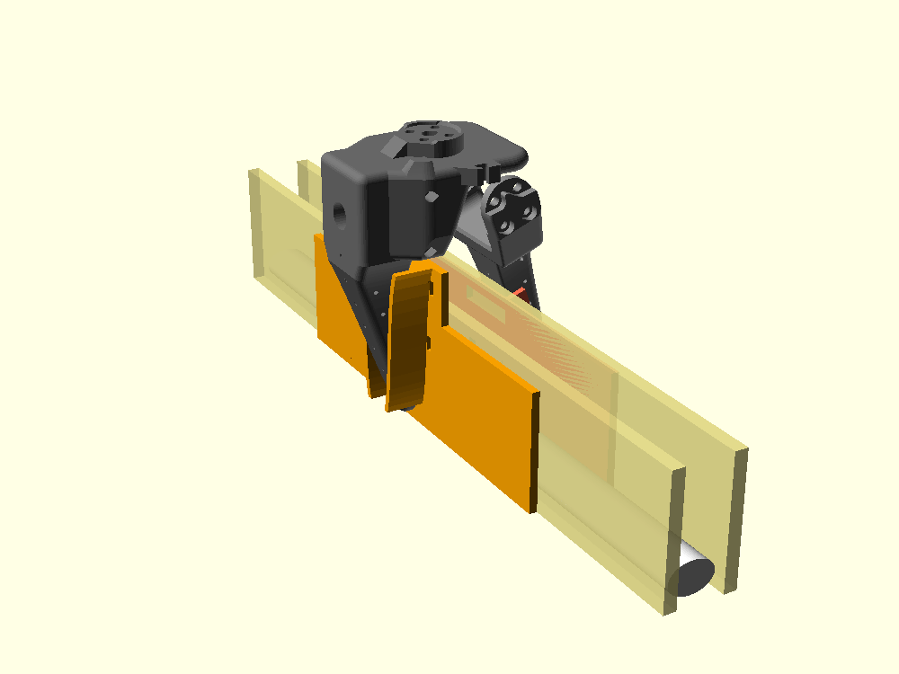
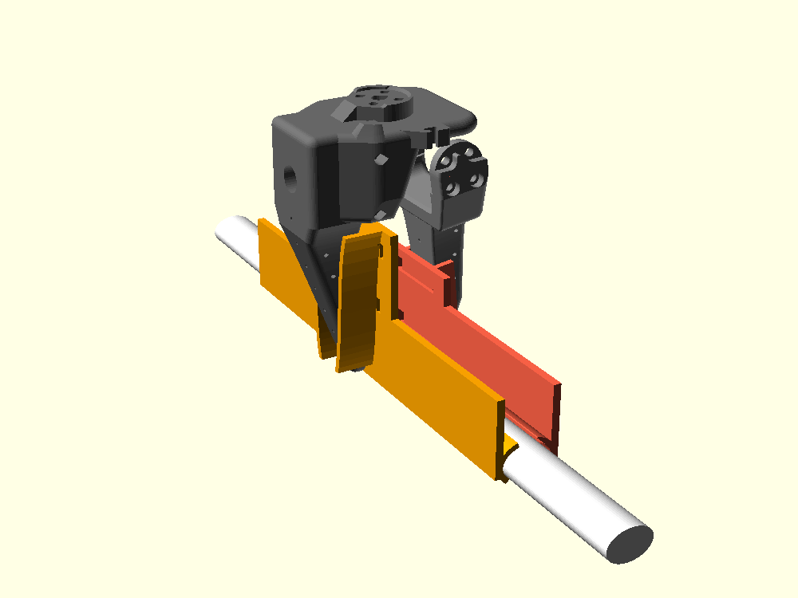
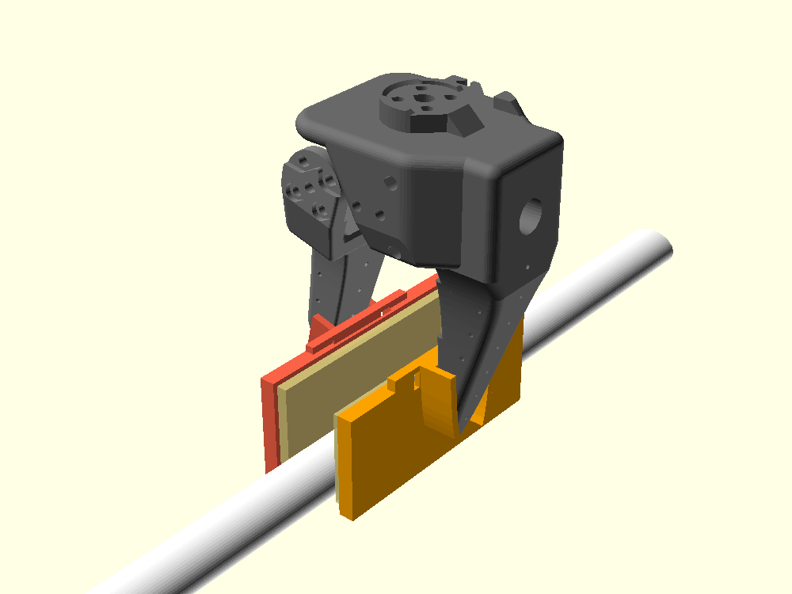
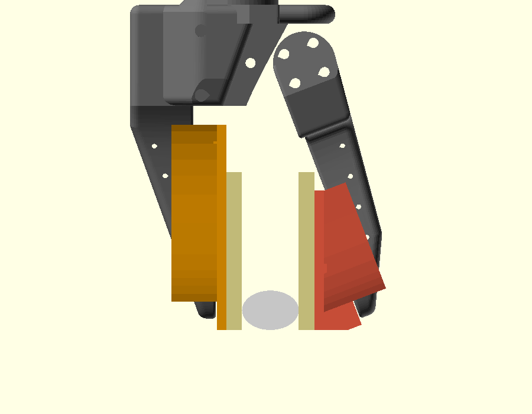
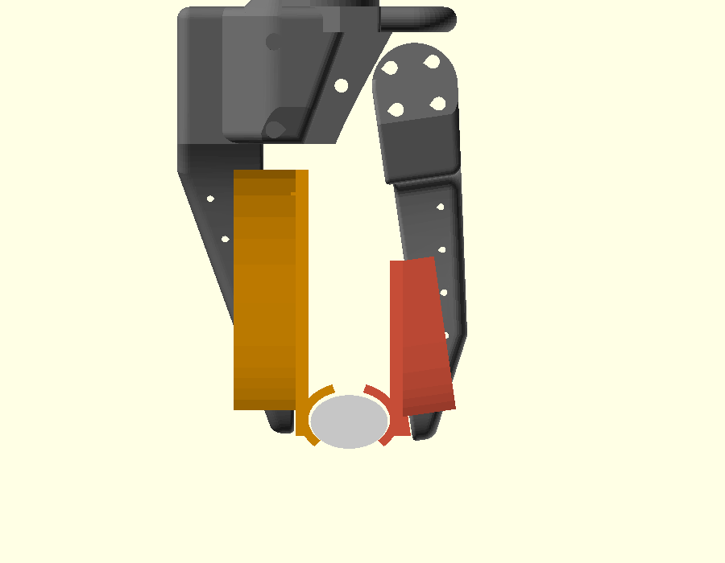
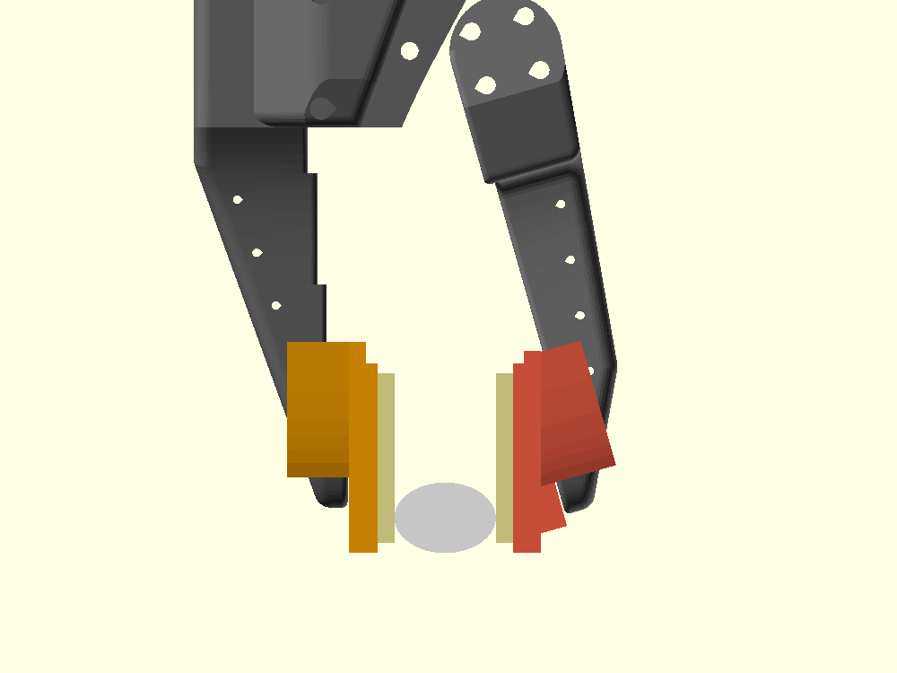
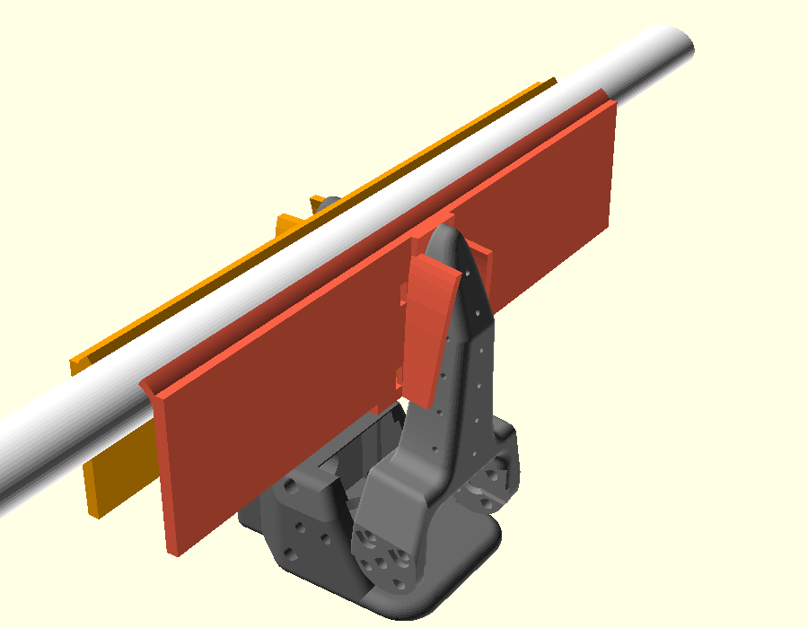
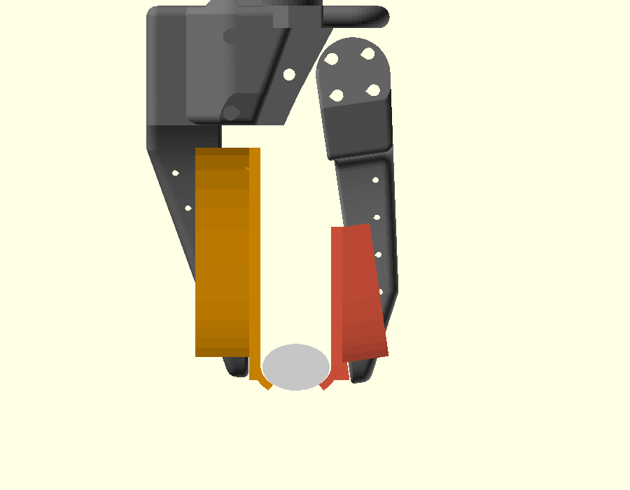

# 코일 집게 덧판 (2026-11-15)

지금 달린 SO-101 집게를 그대로 두고, 두 손가락 안쪽 면에 얹어 **케이블타이 2줄씩**으로 묶는 덧판이다.
손가락 안쪽 면의 계단이 덧판을 길이 방향으로 잡아 주고, 양옆 볼이 좌우를 잡는다. 나사·접착 없이 뗐다 붙인다.

| | 평판형 `flat` | 라운드형 `round` | 손끝 쐐기 `wedge` |
|---|---|---|---|
| 무엇 | 160 × 45 평판. 앞면에 안감을 붙인다: 우드락 5mm 또는 스펀지 테이프 1mm | 묶음 단면을 따라 굽은 받침 180mm. 옆을 누르면서 아래를 받친다 | 손가락 끝 계단 3칸에만 얹는 79.6 × 33.6 판. 앞면에 1.5mm 너비·2mm 높이 턱을 둘러 우드락 토막(76 × 30 × 5)을 끼운다. 11/15 손으로 만든 '우드락 손끝 덧댐'의 인쇄판 |
| 그림 |  |  |  |
| 옆모습 |  |  |  |
| 물었을 때 집게 벌림 | 우드락 20.9° · 테이프 9.6° | 8.2° | 15.9° |
| 무게(PLA 속 100%) | 39g + 34g (테이프용 39g + 29g) | 39g + 29g | 14g + 13g |
| 타이 | 2줄씩 | 2줄씩 | 1줄씩 |

두 판은 **묶음 폭(`grip_w` = 18mm)을 물었을 때 서로 평행**이 되도록 움직이는 쪽에 쐐기를 넣었다.
집게는 돌면서 닫히므로 다른 폭에서는 판이 조금 벌어지거나 오므라진다 — 폭이 바뀌면 `grip_w`를 고쳐 다시 뽑는다.

## 뽑기

```
openscad -D 'part="flat_fixed"' -o stl/flat_fixed.stl coil_gripper.scad
```

`stl/`에 아홉 개가 있다: `flat_fixed` `flat_moving` `flat_moving_tape` `round_fixed` `round_moving` `wedge_fixed` `wedge_moving` `j_fixed` `j_moving`.

평판형의 안감은 둘 중 하나를 고른다. 고정 쪽(`flat_fixed`)은 같고 **움직이는 쪽만 다르다** — 안감 두께로 쐐기 각이 정해지기 때문이다.

| 안감 | 움직이는 쪽 | 쓰임 |
|---|---|---|
| 우드락 5mm (300 × 50) | `flat_moving` | 코일 길이 전체를 받친다 · 홈 두 곳 집게(이빨 달린 우드락) |
| 스펀지 테이프 1mm | `flat_moving_tape` (`-D foam=1`) | 판(160 × 45)으로 바로 문다. 덜 벌린다 |

**J자 `j`**(11/19): 11/13 손 스케치 2안(`sketch_b.scad`)의 인쇄판. 라운드형에서 위로 감싸는 호를 빼고, 곧은 벽(판)으로 옆을 누르면서 아래 호(`j_lip` 50°)로 받친다.
안장·타이 2줄·길이 180·뽑는 방향은 라운드형 그대로. 스케치의 300mm는 베드(220)에 안 들어가 180으로 줄였다(`round_len`).  

손끝형(`tip`, 끝 29mm에만 얹고 타이 1줄)은 11/15에 평판형으로 합쳤다 — 하는 일이 같고 평판형이 더 단단히 묶인다.

- 평판형: 판 앞면이 바닥.
- 쐐기: 턱 끝이 바닥, 안쪽 판은 2mm 떠서 **다리(브리지)로 뽑힌다**(짧은 쪽 27mm). 서포트 없이 되지만 못 미더우면 판 밑에만 서포트. 바닥 닿는 면이 3.3cm²뿐이라 **브림 5mm**. 서포트 없이 나온다.
- 라운드형: 받침이 앞면 아래로 6mm 내려온다 → **길이 방향을 세워서** 뽑거나(안장 밑에 서포트), 앞면을 바닥에 두고 받침 밑에 서포트를 댄다.
- 속 채움 15~20%면 된다. 벽 3줄.

## 달기

1. 고정 손가락(손목 쪽 몸통에 붙은 것)에 `*_fixed`, 움직이는 손가락에 `*_moving`. 안쪽 면에 대고 손끝 쪽으로 밀어 계단에 앉힌다.
2. 판의 구멍 두 쌍에 케이블타이(폭 4.8 이하)를 넣어 손가락 등을 감아 조인다. 타이 머리는 손가락 등 쪽에 둔다. 판 앞면에는 타이가 들어가는 홈이 있어 우드락이 뜨지 않는다.
3. 평판형: 우드락 300 × 50을 판 아래 끝에 맞춰 붙인다. 안쪽에 얇은 스펀지 테이프를 붙이면 덜 미끄러진다.
4. 덧판 아래 끝은 손가락 끝보다 3.6mm(쐐기 8mm) 길다 — 바닥에는 덧판이 먼저 닿는다.
5. 쐐기: 우드락 76 × 30을 턱 안에 눌러 넣고 양면테이프. 턱이 2mm라 5mm 우드락이 3mm 솟는다. 움직이는 쪽 판은 안장 시작 높이보다 위로 못 올라간다(그 위는 손가락 안쪽 면이 판 뒷면보다 안쪽이라 닿는다) — 우드락 높이를 키우려면 `wedge_over`를 같이 키운다. `assert`가 막는다.

⚠ **집게를 끝까지 닫는 값(0)을 주지 않는다.** 물체를 문 채 0을 주면 과부하로 팔이 떨어진 적이 있다(10/30).
판이 서로 닿기 직전 값을 먼저 찾아 그 값을 닫힘 하한으로 쓴다.

## 인쇄 전에 잴 것

치수는 공식 SO-101 STL(`ref/`)을 잘라 잰 값이다. 실물은 아직 대 보지 않았다.

- **회전축 위치**: 집게 서보 축 중심에서 고정 손가락 안쪽 면(뿌리 쪽 평평한 곳)까지 33.5mm인지. 축 위치는 공식 URDF 값(20.2, 24.35)을 썼고, 다르면 `PIV`를 고친다 — 틀리면 판이 평행이 안 된다.
- **손가락이 공식 STL 그대로인지**: 고무·테이프를 붙였거나 다른 판이면 `clr`(지금 0.3)을 키우거나 붙인 것을 뗀다.
- **묶음 폭·높이**: `grip_w` 18, `grip_h` 12.5는 사진에서 읽은 값이다.
- **손목 D405**: 판이 좌우로 80~90mm씩 나온다. 카메라·케이블과 닿는지, 화면을 가리는지 본다.

## 참고: 산업용 평행 전동 그리퍼(DOBOT PGE-2)와 견줘 본 것 (11/19)

출처 = Gemini 문답 <https://share.gemini.google/aYtpWHzm8yml> (PGE-2 매뉴얼 사진을 보고 "비슷하게 직접 만들면 얼마나"를 물은 것. 비용·기간은 Gemini 추정이고 검증하지 않았다).

- **본체는 두고 손가락(팁)만 맞춘다**가 그쪽 결론이기도 하다 — 이 덧판이 그 길이다. 본체까지 새로 만드는 것은 서보+인쇄 1~2주·3~8만 원, 리드스크류+MGN 레일+알루미늄 3~6주·15~40만 원으로 봤다.
- **평행 이동**: PGE-2는 손가락이 평행으로 움직인다. 이 덧판은 돌면서 닫히므로 `grip_w` 한 폭에서만 평행이다. 묶음 폭이 여러 가지가 되면 그때 랙·피니언(또는 4절 링크) 평행 집게로 간다 — 집게 서보(STS3215)를 그대로 쓰면 구동 회로는 새로 안 만든다.
- **물었는지 알기**: PGE-2의 Object Caught는 전류로 본다. 여기선 STS3215 부하값을 이미 읽고 있다(`ros2/tools/stem_grasp.py`·`servo_load_probe.py`) — 코일에도 그 경로를 쓴다. 손끝 압력 센서는 안 단다.
- **하중**: PGE-2 수직 35N·모멘트 0.2N·m는 가이드 레일·알루미늄이 받는다. 인쇄 덧판은 판이 좌우 80~90mm 나와 끝을 누르면 휜다 — 코일 묶음(수십 g)에는 남지만 무거운 물건으로 넘어가면 판 두께 `t`부터 본다.

## 검사

```
openscad -D 'part="check_flat"'  -o x.stl coil_gripper.scad   # "Current top level object is empty" 여야 정상
openscad -D 'part="check_round"' -o x.stl coil_gripper.scad
openscad -D 'part="check_wedge"' -o x.stl coil_gripper.scad
openscad -D 'part="check_j"'     -o x.stl coil_gripper.scad
```

덧판과 손가락, 덧판끼리 겹치는 부피만 남긴다. 넷 다 비어 있다(11/15, j는 11/19, `-D foam=1`에서도). `-D chk=1|2|3`으로 고정판↔손가락 / 움직이는 판↔손가락 / 판끼리를 따로 본다. `-D clr=-1`로 일부러 겹치게 하면 부피가 나온다.

`ref/`의 STL 두 개는 TheRobotStudio/SO-ARM100(Apache-2.0)에서 받은 것이다.
